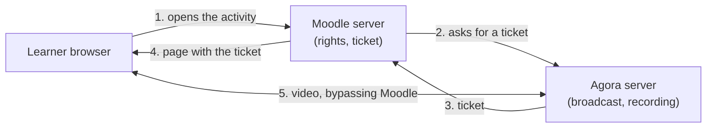

# How it works

For: the Moodle administrator.

Section topics: [Glossary](00-glossary.md) · **How it works** · [What you need](02-prerequisites.md) · [Service accounts](03-agora-accounts.md) · [The stream template, closed playback and the tag](04-agora-template.md) · [Installing and upgrading the plugin](05-install.md) · [Site settings](06-settings.md) · [The System status report](07-status-report.md) · [Background tasks and capabilities](08-tasks-and-permissions.md) · [The recycle bin and the event log](09-recycle-bin-and-log.md) · [Troubleshooting](10-troubleshooting.md) · [What the Agora operator sees](11-agora-console.md) · [Limitations and what this version does not do](12-limits.md)

---

The `mod_agora` plugin adds the **Agora broadcast** activity to Moodle. The
learner opens it like any other course activity and watches the session right
on the course page — no second login, no links to outside sites.

The division of duties is simple:

- **Moodle decides who may watch.** Enrolled in the course, the activity is
  available, access restrictions are satisfied — then yes.
- **Moodle issues the ticket.** For one person, for one stream, for a set
  lifetime.
- **The Agora server serves the video against the ticket** — straight into the
  learner browser.

The main consequence: **video does not go through the Moodle server**. However
many learners watch, the Agora server carries the load and Moodle stays an LMS.

Without the picture, in words:

1. The learner opens the course activity.
2. Moodle checks their rights and asks the Agora server for a ticket for that
   stream.
3. The Agora server returns the ticket.
4. Moodle serves the learner a page with an embedded player and the ticket.
5. The learner browser takes the video straight from the Agora server.

The single exception to "video bypasses Moodle" is the thumbnail frame on the
activity card: the Moodle server fetches it from Agora itself and keeps it in a
cache for a minute. That is one picture per stream per minute, not a stream.

A learner who arrives before the start can stay on the page that says "The
broadcast has not started yet": every 15–20 seconds the page asks Moodle (not
Agora) whether the broadcast has started and shows the player on its own. That
is a small request served from the cache; Moodle asks the Agora server for the
state of the stream at most once per 15 seconds per stream, however many
learners are waiting.

---

← Previous: [Glossary](00-glossary.md) · Next: [What you need](02-prerequisites.md) →
