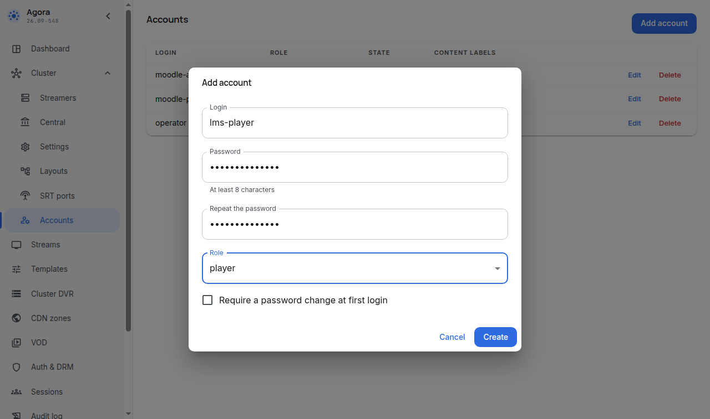
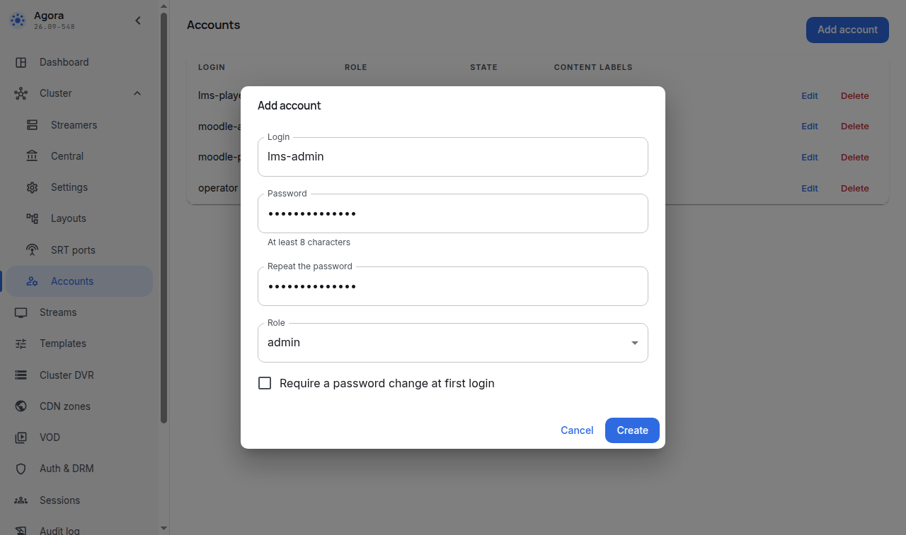
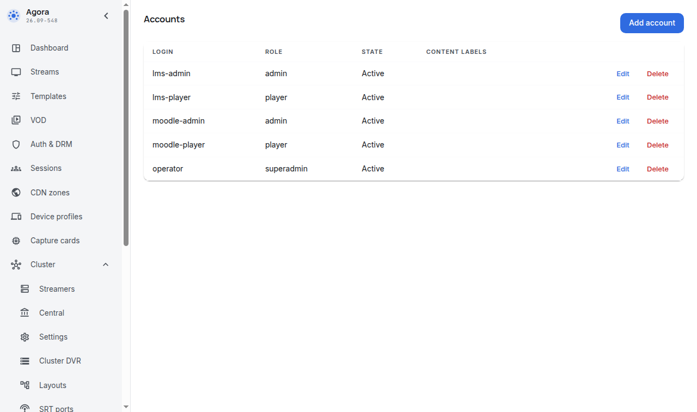

# Service accounts

For: the Moodle administrator.

Section topics: [Glossary](00-glossary.md) · [How it works](01-how-it-works.md) · [What you need](02-prerequisites.md) · **Service accounts** · [The stream template, closed playback and the tag](04-agora-template.md) · [Installing and upgrading the plugin](05-install.md) · [Site settings](06-settings.md) · [The System status report](07-status-report.md) · [Background tasks and capabilities](08-tasks-and-permissions.md) · [The recycle bin and the event log](09-recycle-bin-and-log.md) · [Troubleshooting](10-troubleshooting.md) · [What the Agora operator sees](11-agora-console.md) · [Limitations and what this version does not do](12-limits.md)

---

Everything in this section is done by the operator in the Agora console, once
per Moodle site.

The plugin talks to the Agora server under three accounts with different
roles. The split is not a formality: the one that issues tickets must not be
able to change anything, and browser-broadcast tickets are issued by a
separate account, so the Agora logs tell viewing apart from publishing. The
`superadmin` account from section [What you need](02-prerequisites.md) is not
used by the plugin and is never entered into Moodle: the operator needs it
once, to create these three accounts in the console.

| Role | What it does | Why the plugin needs it |
|---|---|---|
| `player` | issues and revokes viewing tickets | let the learner reach the video and take the access away on unenrolment |
| `admin` | reads lists of streams and templates, stream states, viewing history, the admission policy, recordings and exports | show the stream list in the form, the state badge on the card, count watched minutes, build the recording ticket with its clip |
| `player` (the `publisher` account) | issues publish tickets for in-browser broadcasting over WHIP | in-browser broadcasting (currently hidden, see below): the teacher's browser publishes into the stream on such a ticket |

The first two are mandatory: without them even viewing does not work. The
third is needed only for in-browser broadcasting; without it the "How to
broadcast" block and encoder publishing over SRT work as before. The third
account has the same `player` role — the Agora server does
not distinguish admission kinds yet, so the plugin tells them apart by using
a dedicated account.

> **In-browser broadcasting is temporarily hidden** (frozen 2026-10-16):
> the activity page shows no button regardless of configuration, and the
> publisher page is reachable only at the direct address
> `/mod/agora/publish.php?id=<activity>`. You can skip the third account
> while the feature is hidden: its settings (the publisher account, the
> publish ticket and the WHIP address) are hidden from
> [the settings page](06-settings.md) too.

Open the **Accounts** section of the Agora console and press **Add account**.
Enter the login, the password twice, and pick the `player` role.

Repeat for the second account, picking the `admin` role.

If you plan in-browser broadcasting (currently hidden — see the note above),
create the third account as well — the
`player` role again, with a telling login such as `lms-publisher`.

Use telling logins — the console will then show whose accounts these are.

Rules worth knowing in advance:

- **One set per Moodle site.** Two LMSs must not share an account.
- **Disabling or deleting the `player` account revokes every ticket it
  issued.** Learners stop watching at once.
- **Changing the password leaves tickets alone** — the plugin simply logs in
  again. Rotate the passwords when the LMS administrator changes.

The passwords of these accounts are needed in section
[Site settings](06-settings.md): save them now.

---

← Previous: [What you need](02-prerequisites.md) · Next: [The stream template, closed playback and the tag](04-agora-template.md) →
