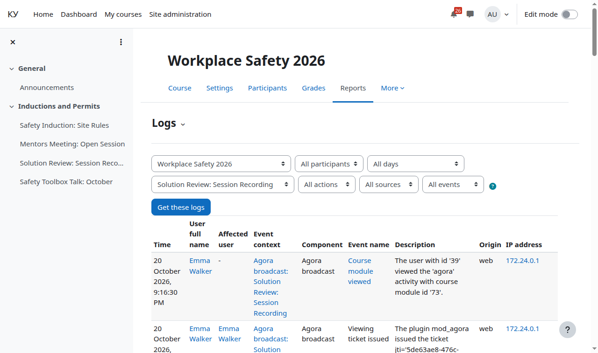

# The recycle bin and the event log

For: the Moodle administrator.

Section topics: [Glossary](00-glossary.md) · [How it works](01-how-it-works.md) · [What you need](02-prerequisites.md) · [Service accounts](03-agora-accounts.md) · [The stream template, closed playback and the tag](04-agora-template.md) · [Installing and upgrading the plugin](05-install.md) · [Site settings](06-settings.md) · [The System status report](07-status-report.md) · [Background tasks and capabilities](08-tasks-and-permissions.md) · **The recycle bin and the event log** · [Troubleshooting](10-troubleshooting.md) · [What the Agora operator sees](11-agora-console.md) · [Limitations and what this version does not do](12-limits.md)

---

## The course recycle bin and stream deletion

A stream **created from a course** is deleted on the Agora server once the
course recycle bin is emptied:

- the bin is on — the period comes from `tool_recyclebin | coursebinexpiry`;
- `coursebinexpiry = 0` ("never clean") — the stream is never deleted;
- the bin is off — the period comes from the plugin setting "Tombstone period
  without the recycle bin, days".

Restoring the activity from the bin before the deadline cancels the deletion.

**Streams created by the operator are never deleted by the plugin** — even when
the course activity that pointed at them is gone.

After a stream is deleted its recording becomes unavailable; the storage is
freed by the Agora cleaner, not by the delete command.

## The event log

**Reports → Logs.** The plugin writes its own events there:

| Event | When | What the record carries |
|---|---|---|
| "Viewing ticket issued" | a learner was issued a ticket | the `jti` and the stream; the ticket itself (JWT) never goes into the log |
| "Ticket issued without address binding" | binding is on, but the learner address as Moodle sees it is not an IP or is unknown | the `jti` and the address as it came — one record per learner per hour; fixed by the Moodle settings `reverseproxy` and `getremoteaddrconf` — until then the player link plays from any address |
| "Agora refused" | the Agora server or a delivery node refused an operation of the plugin | the operation, the account or the service ticket, the code, the reason and the full response body |
| "Preview frame is missing" | a stream has no cover | the step (the frame at the node or the service ticket from the Agora server), the code, the reason word and its description — one record per stream, step, reason and code per hour |
| "Broadcast started" | the teacher pressed "Start broadcast" | the activity and the stream; the recording start in Agora is logged too |
| "Broadcast ended" | a broadcast was brought to completion: by button, by silence, or after the system closed the recording | the way it ended ("ended by the teacher", "ended automatically after the signal went silent", "ended automatically, the recording was closed by the system") and the moment; a task-driven ending has no user |
| "Broadcast action failed" | a completion step (stop the recording, remove the publication) was refused or the network failed | which action failed and why; the completion is not terminal — the button and the scheduled task retry it |
| "An already running recording adopted" | the stream was already being recorded when the teacher pressed "Start broadcast" | whose recording it was; the plugin adopted it and named it after the activity only when the owner is the plugin account |
| "Publish key revealed" | the teacher pressed "Show address" | who and which activity; the key itself is never written to the event |
| "Publish key rotated" | the teacher pressed "Rotate key" | who and which activity; neither the old nor the new key value goes into the log |
| "Publish ticket issued" | the publisher page got a ticket for in-browser broadcasting (currently hidden) | the `jti` and the stream; the ticket (JWT) never goes into the log |
| "Recording without an export for over an hour" | a recording is ready but has had no finished export for over an hour | the recording and the stream — one record per recording; the count of such recordings is shown in the "Publication is set up" check |

The records are in English, like core events: for example
`Agora refused 'read the archive window of a stream (oparchiverange)' as service ticket: HTTP 403`
is not the same as a 403 when issuing a ticket. A failed ticket revocation (on
unenrolment or when the learner changes address) is the same kind of record
with the operation `oprevokegrant` and the account `player`: the ticket then
lives in Agora until it expires. If the failure happened in Moodle itself, not
in Agora (a lock, the database), the record says so: the reason is the class
name of the error, the code is `0`. To avoid drowning in the log of the whole
course, pick the activity you need in the filter.

---

← Previous: [Background tasks and capabilities](08-tasks-and-permissions.md) · Next: [Troubleshooting](10-troubleshooting.md) →
