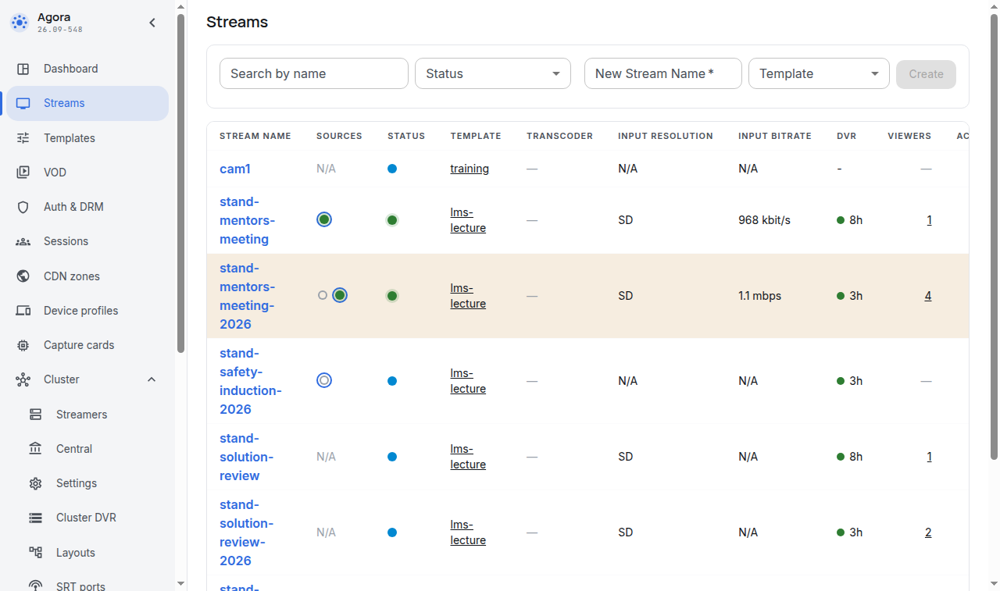
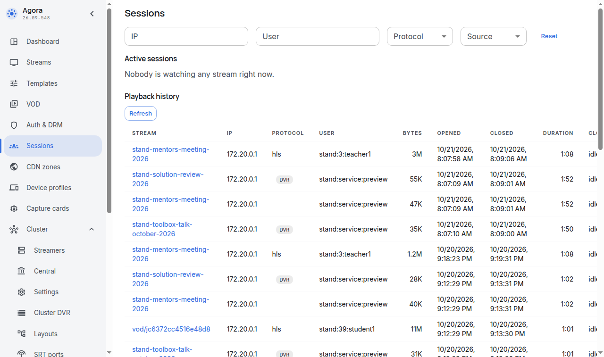

# What the Agora operator sees

For: the Moodle administrator.

Section topics: [Glossary](00-glossary.md) · [How it works](01-how-it-works.md) · [What you need](02-prerequisites.md) · [Service accounts](03-agora-accounts.md) · [The stream template, closed playback and the tag](04-agora-template.md) · [Installing and upgrading the plugin](05-install.md) · [Site settings](06-settings.md) · [The System status report](07-status-report.md) · [Background tasks and capabilities](08-tasks-and-permissions.md) · [The recycle bin and the event log](09-recycle-bin-and-log.md) · [Troubleshooting](10-troubleshooting.md) · **What the Agora operator sees** · [Limitations and what this version does not do](12-limits.md)

---

**Streams** — every stream of the server, the ones created from courses
included. Those created from a course carry the `moodle.<site label>` tag,
which makes them easy to find and to clean up.

**Sessions** — who is watching what right now and what they watched before. A
learner appears in a session not as an address but as an identifier of the form
**`label:number:login`** — for example `hr-lms:42:ivanov`. That is how the
operator tells people apart, and the label keeps two Moodle sites on one Agora
server from mixing up people with the same numbers.

The identifier is built once, at the first ticket issue: renaming a person in
Moodle does not break their viewing history.

Separately, the sessions contain records of the form `label:service:preview` —
these are not learners but service calls of the Moodle server for the thumbnail
frame and for the bounds of a recording (where to start and stop playing it). Such a ticket is issued for one stream, one hour, up to ten screens, and is
reused: every web node and cron node of Moodle reaches the Agora node from its
own address, and every such address is a separate session (checked on the
stand). Service sessions count towards the total session count of the server
and towards the licence session limit. A service ticket is not bound to an
address: it is presented by the Moodle server, not by a browser — which is why
the Moodle server reads the bounds of a recording with it and not with the
learner's ticket, which the node would refuse to the server when binding is on.

A viewing session is also closed in **Sessions** when a learner is unenrolled:
see the [teacher document](../teacher/08-unenrol.md).

---

← Previous: [Troubleshooting](10-troubleshooting.md) · Next: [Limitations and what this version does not do](12-limits.md) →
