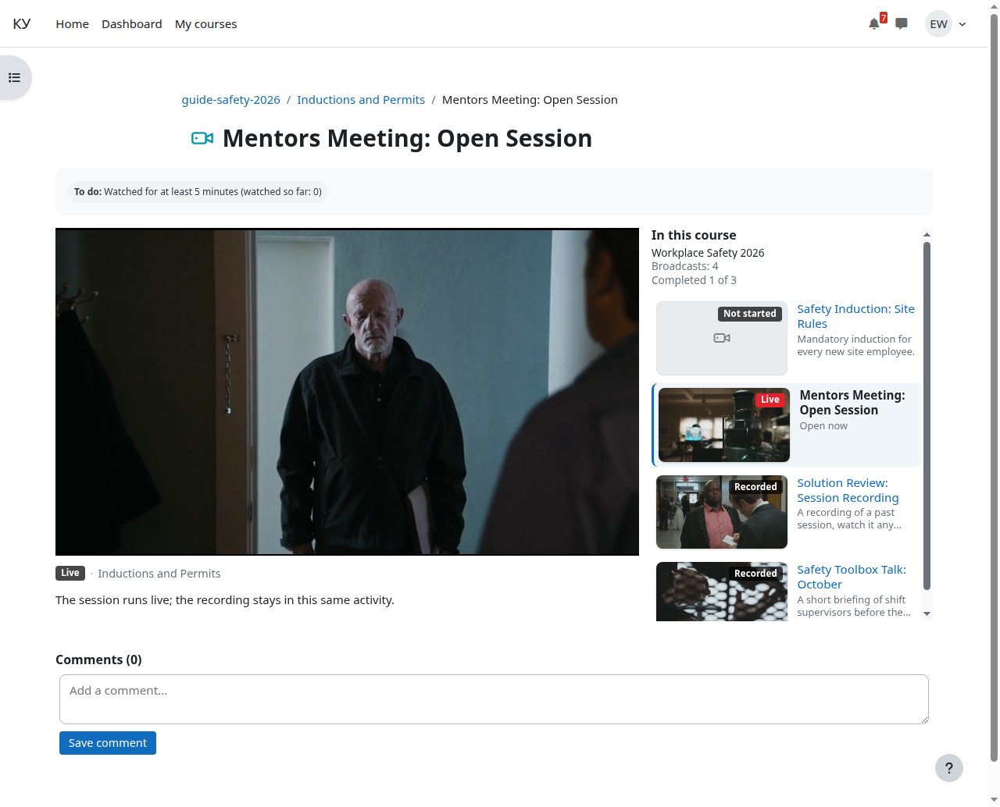
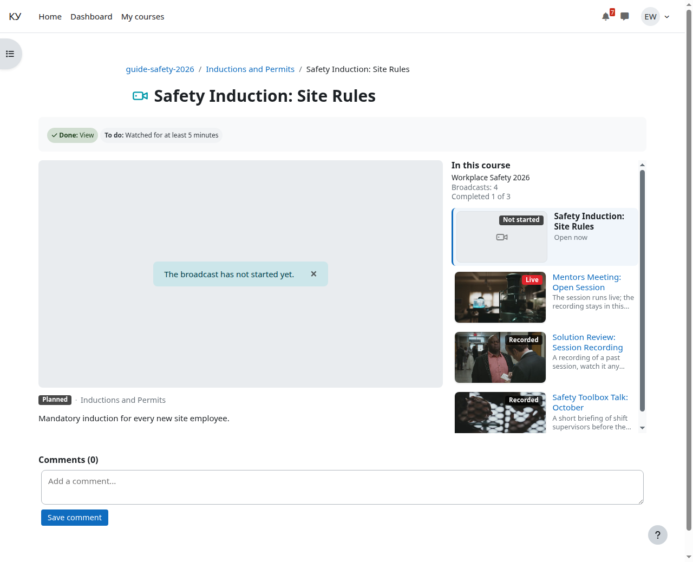

# Badges and placeholders

For: the learner.

Section topics: [Opening a broadcast](01-open.md) · **Badges and placeholders** · [The broadcast page](03-broadcast-page.md) · [The recording after the broadcast](04-recording.md) · [Why it may not play](05-not-playing.md) · [Where to see your own completion](06-completion.md)

---

The badge next to the activity name tells you what is there right now.

| Badge | What it means | What is on the page |
|---|---|---|
| **Planned** | the teacher is getting the broadcast ready, learners are not let in yet | "The broadcast has not started yet" |
| **Live** | the session is running right now | the broadcast player |
| **Signal lost** | the signal broke off under three minutes ago | "The signal is gone, the broadcast will resume shortly"; a link to the recording if one exists |
| **Ended** | the session is over and the recording is being prepared | "The recording will appear here shortly."; the recording player once the clip is ready |
| **Recorded** | the session is over and the recording is there | the recording player |
| **Not started** | the broadcast has not happened yet | "The broadcast has not started yet" |
| **No recording** | the session is over and was not recorded | "This broadcast was not recorded" |
| **State unknown** | the site could not read the state of the broadcast | a reason code; tell your teacher |

The "Planned" and "Ended" badges belong to activities whose broadcasts the
teacher runs alone: there the signal does not put the broadcast live for
learners, and an ended broadcast does not come back. Every other activity
reads its badge from the stream state, as in the table above.

On the course page the badge refreshes at most once a minute: a lag of up to a
minute is normal, not a fault. The page of the session itself reads the state
fresh — no older than 15 seconds — and an open "The broadcast has not started
yet" placeholder turns into the player on its own once the broadcast starts
(see [The broadcast page](03-broadcast-page.md)).

One exception to "not started": some broadcasts start on a viewer's request.
Those have no placeholder — the player opens right away with the caption "the
broadcast starts on your request, give it a few seconds".

---

← Previous: [Opening a broadcast](01-open.md) · Next: [The broadcast page](03-broadcast-page.md) →
