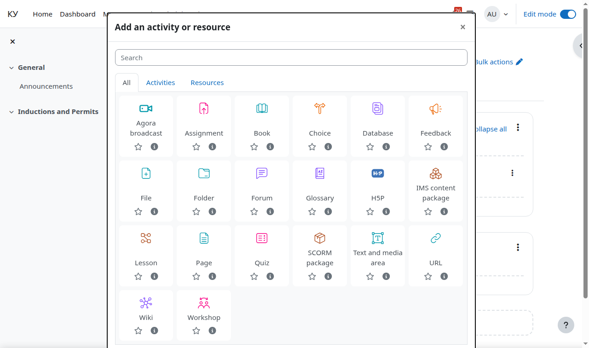
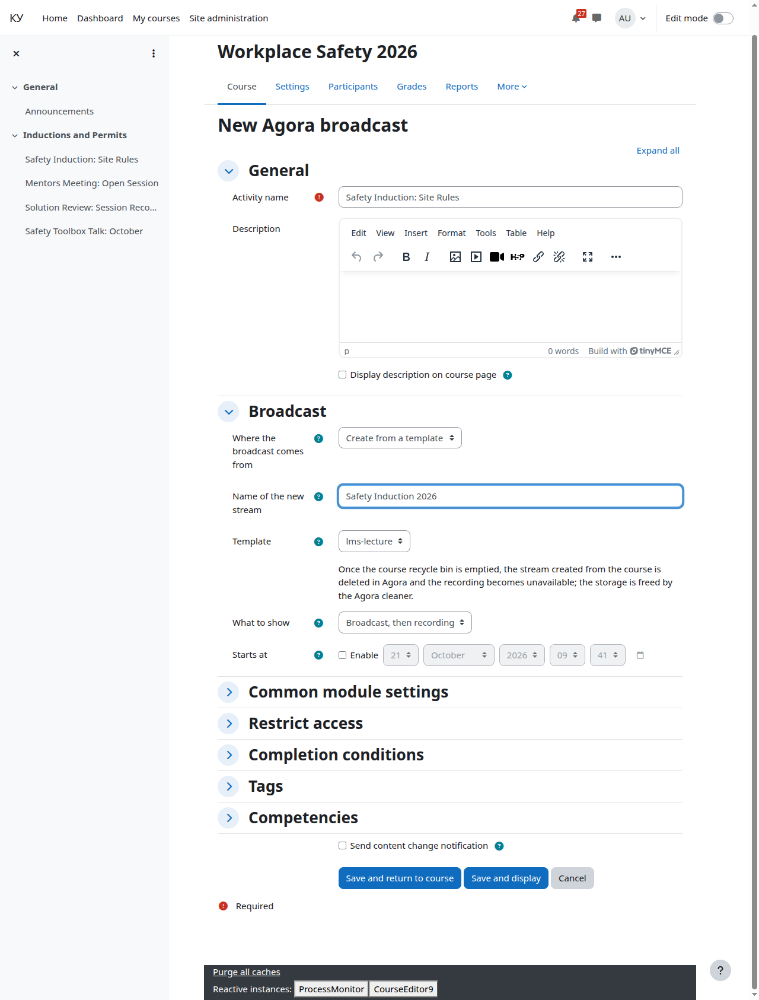
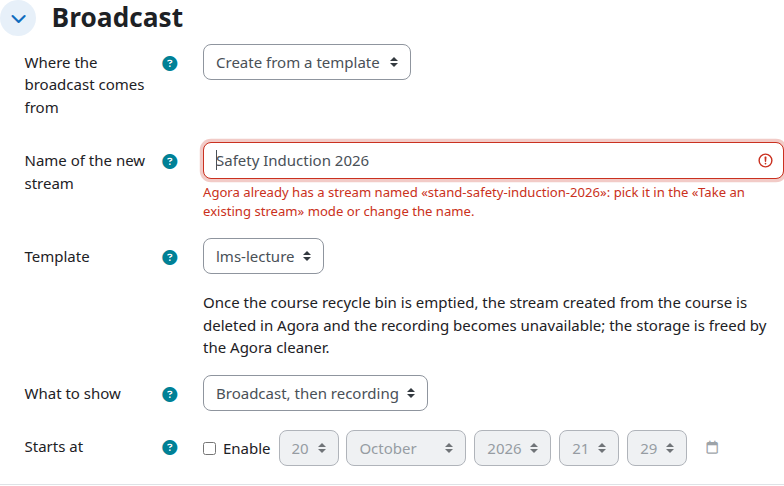
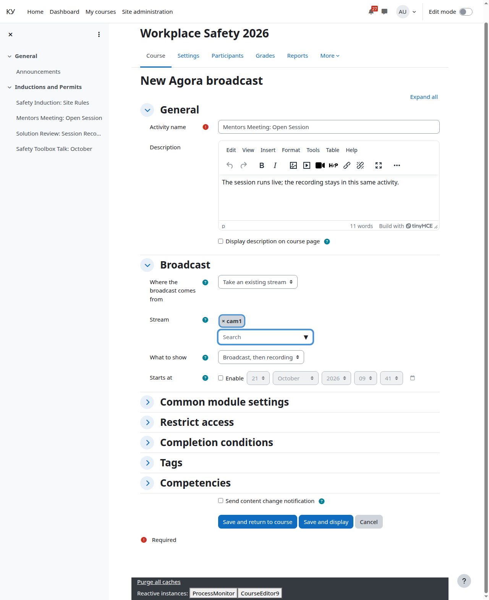

# Adding the Agora broadcast activity

For: the teacher.

Section topics: [The course](01-course.md) · **Adding the Agora broadcast activity** · [What to show, the start date and the description](03-display-mode.md) · [Completion](04-completion.md) · [The course page](05-course-page.md) · [The activity page through your eyes](06-broadcast-page.md) · [Learners: enrolment and groups](07-learners.md) · [Unenrolment and what happens to the ticket](08-unenrol.md) · [The completion report](09-completion-report.md) · [Comments](10-comments.md) · [If it does not play for a learner](11-when-it-does-not-play.md)

---

Turn editing on and press **Add an activity or resource**. Next to Assignment
and Quiz there is now **Agora broadcast**.

The **Broadcast** section of the activity form offers two ways.

## Create from a template

You do not have to wait for the operator. Type the name of the new stream and
pick a template.

The name on the Agora server is built for you: Cyrillic is transliterated and
the site label is prefixed. "Оптика, лекция 3" on a site labelled `hr-lms`
becomes `hr-lms-optika-lekciya-3`. At least one Latin letter or digit must
remain in the name. If such a name is already taken, the form says so right at
the name field (what you typed stays) and suggests picking a stream the second way.

Recording depth, signal sources and thumbnail frames come from the template:
they are not configured from Moodle. The signal source (the camera) is hooked
up by the operator in the Agora console.

A stream created from a course is ready for the teacher to broadcast right
away: it carries a publication section (a port from the site port range and a
generated key) and a recording policy with automatic export — a finished
recording becomes the clip for learners on its own, no operator needed.
Details on running the broadcast are in [The activity page through your
eyes](06-broadcast-page.md).

**A new session is a new activity.** A stream in an activity lives once:
after it ends, the activity keeps its recording, and the next session is
created as a copy. Duplicating the activity (including restoring it from a
course backup) creates a new stream in Agora — with its own name, key and
port; the original stream and its recording stay with the original activity.

**A stream created from a course is deleted together with the activity** —
after the course recycle bin is emptied, recording included. Deletion brings
the stream to a clean state first: a running recording is stopped, the
publication is removed, the tickets are revoked.

## Take an existing stream

The operator has already created a stream — with a camera, quality and
recording. Pick it from the list.

The list holds only the streams the operator tagged for courses. If the stream
you need is missing, ask the operator to add the tag. A stream created by the
operator is never deleted by the plugin.

For such an activity the plugin never changes the stream configuration:
there is no publication section, no recording policy and no broadcast
buttons. The "How to broadcast" block on the activity page is read-only —
the connection string is taken from Agora as the operator configured it —
and the key cannot be rotated: the section belongs to the operator. The
broadcast cannot be started or ended with buttons either: the operator runs
its life cycle in the Agora console, and the activity stays view-only, as in
the first version of the plugin.

---

← Previous: [The course](01-course.md) · Next: [What to show, the start date and the description](03-display-mode.md) →
