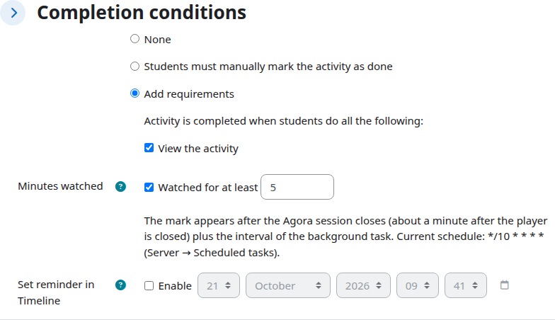

# Completion

For: the teacher.

Section topics: [The course](01-course.md) · [Adding the Agora broadcast activity](02-add-broadcast.md) · [What to show, the start date and the description](03-display-mode.md) · **Completion** · [The course page](05-course-page.md) · [The activity page through your eyes](06-broadcast-page.md) · [Learners: enrolment and groups](07-learners.md) · [Unenrolment and what happens to the ticket](08-unenrol.md) · [The completion report](09-completion-report.md) · [Comments](10-comments.md) · [If it does not play for a learner](11-when-it-does-not-play.md)

---

The "Activity completion" section holds two conditions.

**Viewed** is the standard Moodle condition: the page was opened, so it is
done.

**Watched for at least M minutes** is marked by a background task from the
viewing history of the Agora server, never by a browser timer. There is no
timer on purpose: a timer is defeated by leaving a tab open.

The mark therefore appears **not while watching but after the player is closed
plus the interval of the background task** (10 minutes by default; the actual
schedule is printed right under the field). Minutes add up across viewings and
the learner sees the total in the completion card.

**How the time is counted.** Watching counts from opening the player to its
last request to the Agora server. When a learner closes the tab, the Agora
server keeps the viewing open for about a minute — in case they come back — and
only then closes it. That minute is not counted: a learner who watched for 5
minutes gets 5, not 6, even though the Agora console shows the viewing as six
minutes long. For a short threshold ("2 minutes") this matters: a minute of
idling would be half of the condition. The exception is a viewing closed within
that minute by the broadcast stopping or the ticket being revoked (for example,
the learner opened the session from another address): its minute is counted.

The price of this accounting is worth knowing: the Agora server merges
consecutive viewings by the same person with a gap of up to 30 minutes into
one, and such a gap counts. A learner who stepped away for ten minutes gets
them credited. There is no way to tell a pause from watching.

**A mark is not lost.** The task first saves the collected minutes and sets the
marks as a separate step — for everyone who has reached the threshold and has no
mark yet. If a mark did not get set (a failure on the site, completion switched
off in the course), the next pass sets it on its own, without counting the
minutes again. A mark you removed by hand is left alone. Unenrolled and suspended learners get
no mark. The task remembers a learner for a week after their last ticket for the
session: switch completion on in the course three days later and the marks
still come.

If the Agora server is temporarily unreachable, the task skips the pass:
existing marks are not removed, and "not completed" does not appear instead of
"unknown".

This activity has no numeric grade and no manual marking by the teacher.

---

← Previous: [What to show, the start date and the description](03-display-mode.md) · Next: [The course page](05-course-page.md) →
