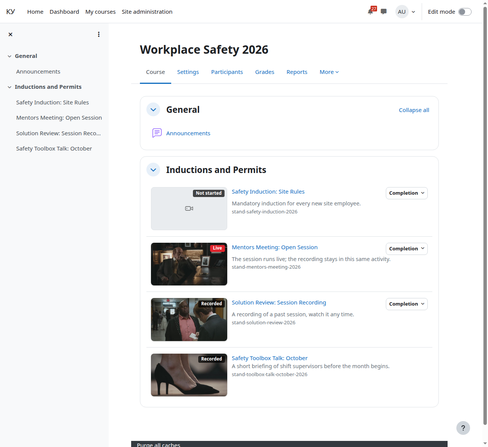

# The course page

For: the teacher.

Section topics: [The course](01-course.md) · [Adding the Agora broadcast activity](02-add-broadcast.md) · [What to show, the start date and the description](03-display-mode.md) · [Completion](04-completion.md) · **The course page** · [The activity page through your eyes](06-broadcast-page.md) · [Learners: enrolment and groups](07-learners.md) · [Unenrolment and what happens to the ticket](08-unenrol.md) · [The completion report](09-completion-report.md) · [Comments](10-comments.md) · [If it does not play for a learner](11-when-it-does-not-play.md)

---

A finished course: every activity carries a state badge and, when the stream
has thumbnails, a cover.

| Stream state | Badge |
|---|---|
| Running | Live |
| Signal lost under 3 minutes ago | Signal lost |
| Over, recording available | Recorded |
| Never started | Not started |
| Over, no recording | No recording |
| State could not be read | State unknown |

The state refreshes at most once a minute: a lag of up to a minute is normal.

---

← Previous: [Completion](04-completion.md) · Next: [The activity page through your eyes](06-broadcast-page.md) →
