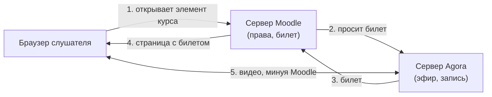

# Как это работает

Кому: администратору Moodle.

Темы раздела: [Словарь](00-glossary.md) · **Как это работает** · [Что понадобится](02-prerequisites.md) · [Служебные учётные записи](03-agora-accounts.md) · [Шаблон эфира, закрытый просмотр и тег](04-agora-template.md) · [Установка и обновление плагина](05-install.md) · [Настройки сайта](06-settings.md) · [Отчёт «Состояние системы»](07-status-report.md) · [Фоновые задачи и права](08-tasks-and-permissions.md) · [Корзина курса и журнал событий](09-recycle-bin-and-log.md) · [Неполадки](10-troubleshooting.md) · [Что видит оператор Agora](11-agora-console.md) · [Ограничения и чего нет в этой версии](12-limits.md)

---

Плагин `mod_agora` добавляет в Moodle элемент курса **«Эфир Agora»**. Слушатель
открывает его как любой другой элемент курса — и смотрит занятие прямо на
странице курса, без второго входа и без ссылок на сторонние сайты.

Разделение обязанностей простое:

- **Moodle решает, кому можно смотреть.** Записан на курс, элемент ему доступен,
  ограничения доступа соблюдены — значит можно.
- **Moodle выписывает билет.** На одного человека, на один эфир, на заданный
  срок.
- **Сервер Agora отдаёт видео по билету** — напрямую в браузер слушателя.

Главное следствие: **видео не идёт через сервер Moodle**. Сколько бы слушателей
ни смотрело, нагрузку несёт сервер Agora, а Moodle остаётся LMS.

Без картинки, словами:

1. Слушатель открывает элемент курса.
2. Moodle проверяет его права и просит у сервера Agora билет на этот эфир.
3. Сервер Agora возвращает билет.
4. Moodle отдаёт слушателю страницу со встроенным плеером и билетом.
5. Браузер слушателя забирает видео прямо с сервера Agora.

Единственное исключение из «видео мимо Moodle» — кадр-обложка на карточке
элемента: его сервер Moodle забирает у Agora сам и держит в кэше минуту. Это
одна картинка на эфир в минуту, а не поток.

Слушатель, пришедший до начала, может остаться на странице с надписью «Эфир ещё
не начался»: страница раз в 15–20 секунд спрашивает Moodle (не Agora), не пошёл
ли эфир, и сама показывает плеер. Это маленький запрос из кэша; к серверу Agora
за состоянием эфира Moodle ходит не чаще раза в 15 секунд на эфир, сколько бы
слушателей ни ждало.

---

← Предыдущая: [Словарь](00-glossary.md) · Следующая: [Что понадобится](02-prerequisites.md) →
