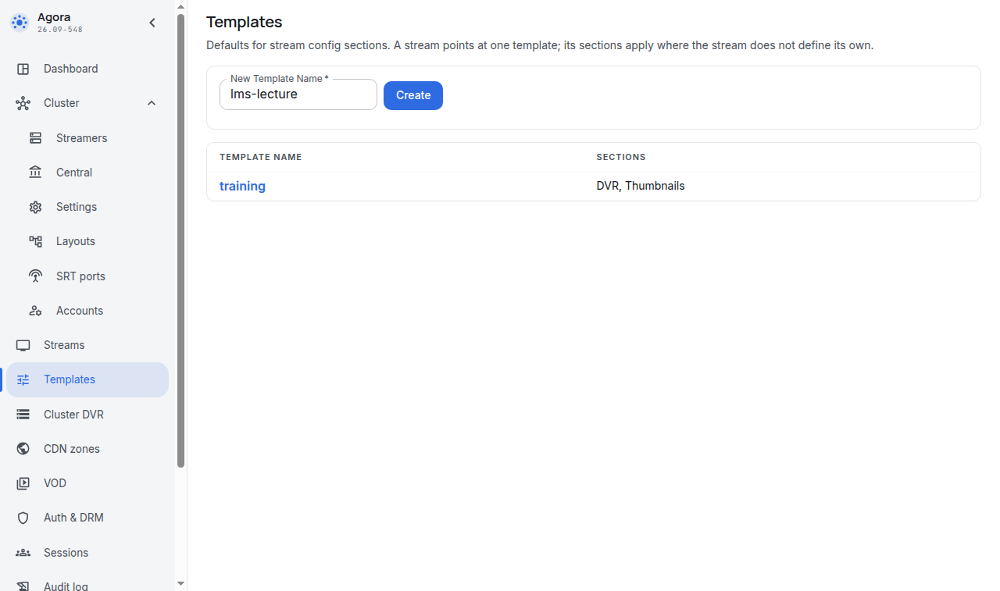
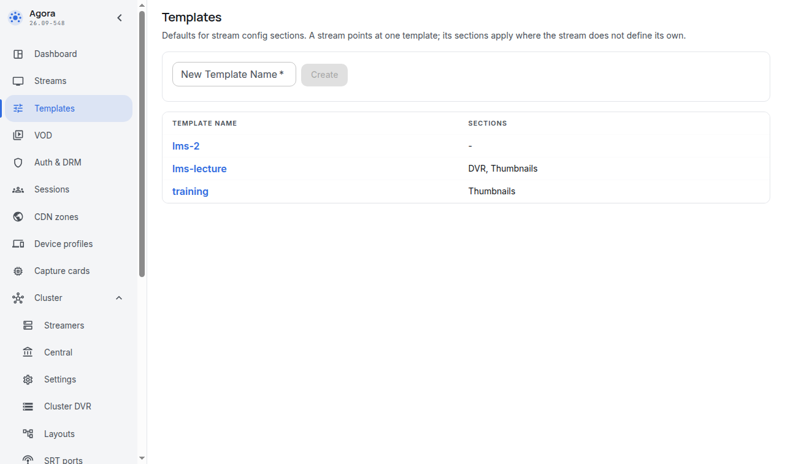
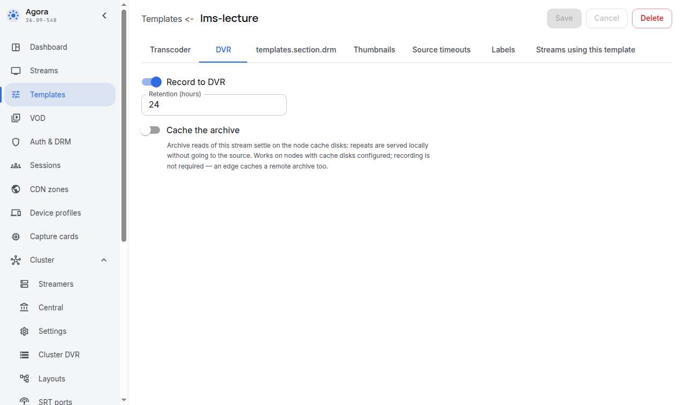
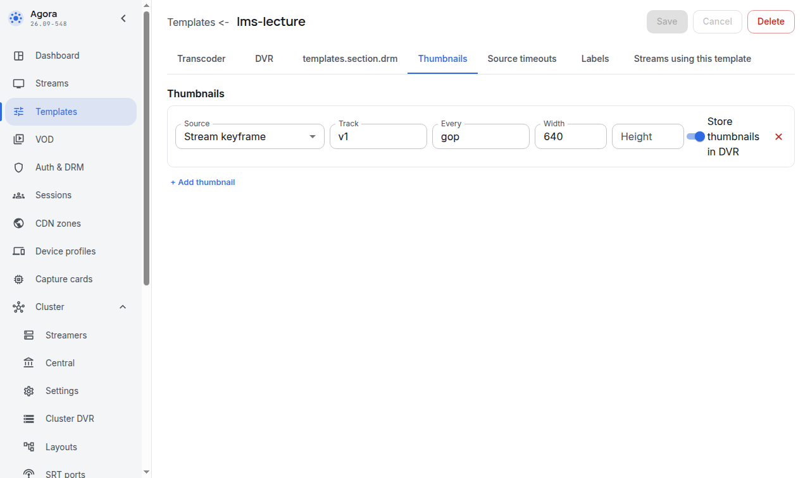
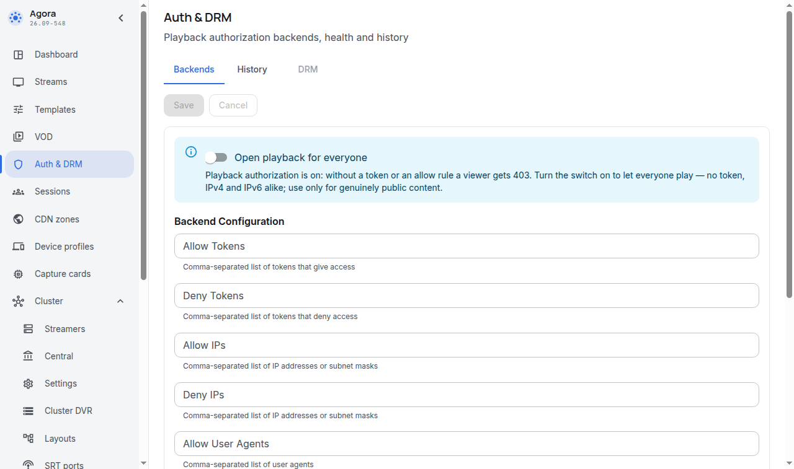

# Шаблон эфира, закрытый просмотр и тег

Кому: администратору Moodle.

Темы раздела: [Словарь](00-glossary.md) · [Как это работает](01-how-it-works.md) · [Что понадобится](02-prerequisites.md) · [Служебные учётные записи](03-agora-accounts.md) · **Шаблон эфира, закрытый просмотр и тег** · [Установка и обновление плагина](05-install.md) · [Настройки сайта](06-settings.md) · [Отчёт «Состояние системы»](07-status-report.md) · [Фоновые задачи и права](08-tasks-and-permissions.md) · [Корзина курса и журнал событий](09-recycle-bin-and-log.md) · [Неполадки](10-troubleshooting.md) · [Что видит оператор Agora](11-agora-console.md) · [Ограничения и чего нет в этой версии](12-limits.md)

---

## Шаблон эфира

Шаблон задаёт, что получит каждый эфир, созданный из курса. Плагин из Moodle
эти настройки не меняет — он только называет шаблон по имени.

Откройте **Templates**, введите имя нового шаблона и нажмите **Create**.

Для учебных эфиров в шаблоне нужны две вещи.

**Запись.** Вкладка **DVR**: включите `Record to DVR` и задайте глубину хранения
в часах. Без записи элемент курса после эфира честно напишет «запись не
велась» — второй раз занятие не посмотреть.

**Кадры-обложки.** Вкладка **Thumbnails**: нажмите `+ Add thumbnail` и задайте
ширину кадра. Секция кадров даёт картинку на карточку элемента в курсе. Без неё
карточки будут без обложек — на просмотр это не влияет, но курс выглядит беднее.
Переключатель `Store thumbnails in DVR` кладёт кадры и в запись: тогда обложка
есть и у прошедшего занятия.

Не забудьте **Save** на каждой вкладке. Запомните имя шаблона: его нужно будет
вписать в настройки плагина.

## Закрытый просмотр

Главная проверка этого раздела. Билет защищает видео только тогда, когда сервер
Agora вообще требует билет.

Откройте **Auth & DRM** и убедитесь, что переключатель открытого проигрывания
для всех (`Open playback for everyone`) **выключен**.

Если он включён, видео отдаётся любому, кто знает ссылку, и всё, что делает
плагин, теряет смысл. Плагин это замечает и пишет предупреждение в отчёт
[«Состояние системы»](07-status-report.md) Moodle и на страницу элемента для
преподавателя.

## Хотя бы один эфир, чтобы проверить связь

Для проверки достаточно одного идущего эфира. Эфир заводится в разделе
**Streams** консоли, источник сигнала задаётся там же:

- **файл-источник** — самый простой способ: эфир крутит заранее положенный на
  сервер файл;
- **публикация** — на эфир публикует сигнал камера, кодировщик или программа
  вещания по RTMP/SRT.

Подробности источников, качества и раскладки — в документации Agora: из Moodle
они не настраиваются и в этом документе не разбираются.

## Тег на эфирах, которые отдаются в курсы

Преподаватель не должен видеть в форме все эфиры сервера. Он видит только те,
которые оператор пометил тегом `moodle.<метка сайта>` — метку вы зададите в
разделе [Настройки сайта](06-settings.md).

Эфир, созданный из курса, получает этот тег сам. Эфиры, заведённые оператором
вручную, оператор помечает сам — в консоли, на вкладке меток эфира.

---

← Предыдущая: [Служебные учётные записи](03-agora-accounts.md) · Следующая: [Установка и обновление плагина](05-install.md) →
