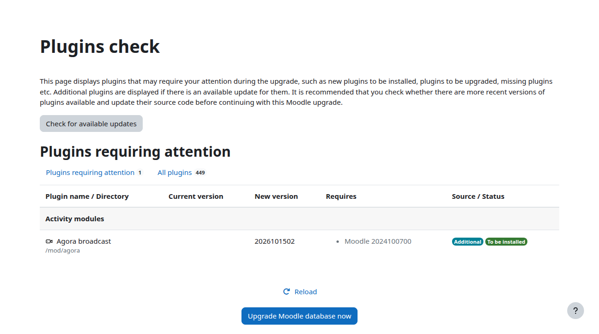
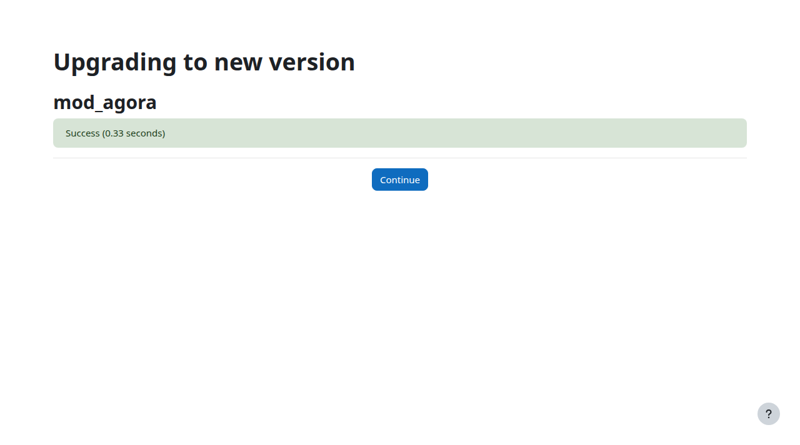
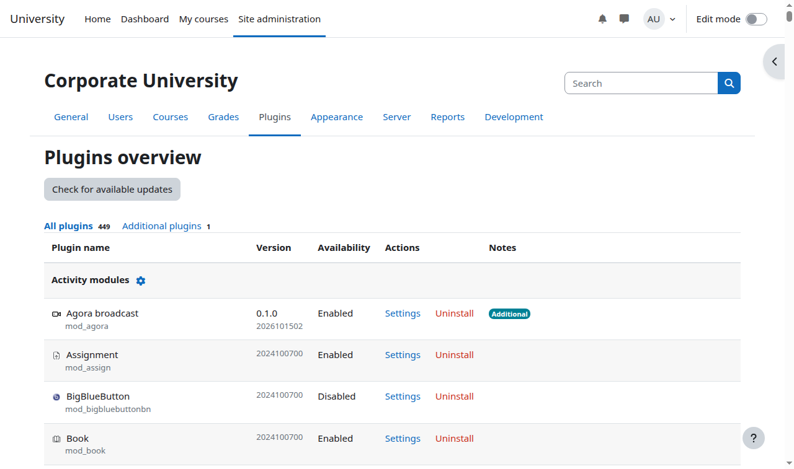

# Установка и обновление плагина

Кому: администратору Moodle.

Темы раздела: [Словарь](00-glossary.md) · [Как это работает](01-how-it-works.md) · [Что понадобится](02-prerequisites.md) · [Служебные учётные записи](03-agora-accounts.md) · [Шаблон эфира, закрытый просмотр и тег](04-agora-template.md) · **Установка и обновление плагина** · [Настройки сайта](06-settings.md) · [Отчёт «Состояние системы»](07-status-report.md) · [Фоновые задачи и права](08-tasks-and-permissions.md) · [Корзина курса и журнал событий](09-recycle-bin-and-log.md) · [Неполадки](10-troubleshooting.md) · [Что видит оператор Agora](11-agora-console.md) · [Ограничения и чего нет в этой версии](12-limits.md)

---

Плагин лежит в репозитории в каталоге `mod_agora/`. В дерево Moodle кладётся
**содержимое** этого каталога, а сам каталог называется `agora`:

```sh
git clone <адрес репозитория> /tmp/moodle-agora
cp -r /tmp/moodle-agora/mod_agora <корень Moodle>/mod/agora
```

Если репозиторий недоступен с сервера Moodle, скопируйте туда архив каталога
`mod_agora` и распакуйте его в `mod/agora`.

Проверьте, что путь получился ровно такой: `<корень Moodle>/mod/agora/version.php`.

## Права на файлы

Файлы плагина должен читать тот пользователь, под которым работает веб-сервер
(обычно `www-data`), и **не должен** иметь право записи — как и остальной код
Moodle:

```sh
chown -R root:www-data <корень Moodle>/mod/agora
chmod -R u=rwX,g=rX,o= <корень Moodle>/mod/agora
```

## Установка в Moodle

Войдите на сайт администратором. Moodle сам заметит новый плагин и покажет
страницу проверки плагинов: «Эфир Agora» в списке со статусом «Должен быть
установлен». Та же страница открывается по «Уведомлениям».



Нажмите «Обновить Moodle» и дождитесь окончания.



Плагин виден в списке: **Администрирование → Плагины → Обзор плагинов**, раздел
«Модули элементов курса».



Ничего больше плагин при установке не просит: ни отдельной базы, ни фоновых
служб. Он добавляет две свои фоновые задачи в общее расписание сайта — о них в
разделе [Фоновые задачи и права](08-tasks-and-permissions.md).

## Обновление плагина

Той же дорогой, что установка: забрать новую версию из репозитория, положить её
поверх `mod/agora`, войти администратором и подтвердить обновление базы.
Настройки подключения и уже созданные элементы курсов при этом сохраняются.

```sh
cd /tmp/moodle-agora && git pull
cp -r /tmp/moodle-agora/mod_agora/. <корень Moodle>/mod/agora/
```

---

← Предыдущая: [Шаблон эфира, закрытый просмотр и тег](04-agora-template.md) · Следующая: [Настройки сайта](06-settings.md) →
