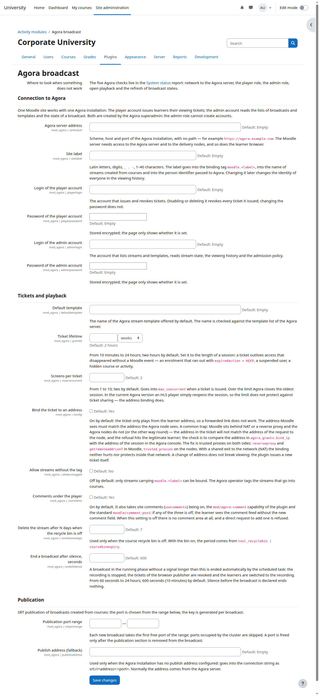
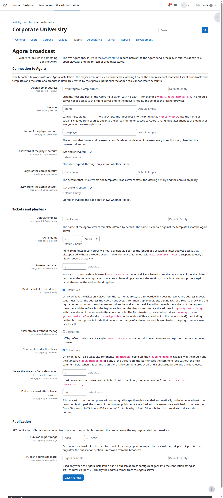

# Настройки сайта

Кому: администратору Moodle.

Темы раздела: [Словарь](00-glossary.md) · [Как это работает](01-how-it-works.md) · [Что понадобится](02-prerequisites.md) · [Служебные учётные записи](03-agora-accounts.md) · [Шаблон эфира, закрытый просмотр и тег](04-agora-template.md) · [Установка и обновление плагина](05-install.md) · **Настройки сайта** · [Отчёт «Состояние системы»](07-status-report.md) · [Фоновые задачи и права](08-tasks-and-permissions.md) · [Корзина курса и журнал событий](09-recycle-bin-and-log.md) · [Неполадки](10-troubleshooting.md) · [Что видит оператор Agora](11-agora-console.md) · [Ограничения и чего нет в этой версии](12-limits.md)

---

Один раз на сайт. **Администрирование → Плагины → Модули элементов курса →
Эфир Agora**.

## Адрес сервера Agora

Поле «Адрес сервера Agora» — это схема, хост и порт **без пути**, например
`https://agora.example.org` или `https://agora.example.org:8443`.

Три вещи об этом адресе:

- **Он один на всех.** По этому адресу к серверу Agora ходит и сервер Moodle
  (за списками эфиров и билетами), и браузер слушателя (за страницей плеера).
  Внутренний адрес, который виден только из серверной сети, не подойдёт.
- **Где взять.** Это тот же адрес, по которому вы открываете консоль Agora.
  Спросите у оператора Agora, если консоль вам недоступна.
- **Порт.** Если Agora слушает нестандартный порт, его нужно написать явно:
  без порта браузер и сервер пойдут на 443 (или 80) и не достучатся.

## Все поля

| Поле | Что писать |
|---|---|
| Адрес сервера Agora | Схема, хост и порт без пути |
| Метка сайта | Латиница, цифры, `_ . -`, 1–40 символов, например `hr-lms` |
| Логин учётной записи `player` | Запись из раздела [Служебные учётные записи](03-agora-accounts.md), выписывающая билеты |
| Пароль учётной записи `player` | Её пароль |
| Логин учётной записи `admin` | Вторая запись из раздела [Служебные учётные записи](03-agora-accounts.md), читающая эфиры |
| Пароль учётной записи `admin` | Её пароль |
| Шаблон по умолчанию | Имя шаблона из раздела [Шаблон эфира](04-agora-template.md#шаблон-эфира); проверяется по списку сервера |
| Срок билета | От 10 минут до 24 часов, по умолчанию 2 часа |
| Экранов на билет | 1–10, по умолчанию 2 |
| Привязка билета к адресу | По умолчанию включена, см. [Привязка билета к адресу](#привязка-билета-к-адресу) |
| Разрешить эфиры без тега | По умолчанию выключено |
| Комментарии под плеером | По умолчанию включены, см. [Комментарии под плеером](#комментарии-под-плеером) |
| Срок отложенного удаления без корзины, дней | 1–3650, по умолчанию 7; см. [Корзина курса и журнал событий](09-recycle-bin-and-log.md) |
| Завершать эфир по тишине, секунд | 60–86400, по умолчанию 600 (10 минут); см. [Завершение по тишине](#завершение-по-тишине) |
| Диапазон портов публикации | Начало и конец, целые порты 1–65535; см. [Публикация эфиров из курсов](#публикация-эфиров-из-курсов) |
| Адрес публикации (запасной) | Только на случай, когда адрес публикации не настроен в самой Agora |

Пароли хранятся зашифрованными: на странице видно только «задан» или «не
задан», обратно они не читаются.

Пять пояснений к полям, которые потом дорого менять или легко понять неверно.

**Метку сайта потом не меняйте.** Она входит в тег `moodle.<метка>`, в имена
эфиров, созданных из курсов, и в идентификатор человека, который уходит на
сервер Agora (`метка:номер:логин`). Смена метки меняет личность всех людей в
истории просмотра и прячет от преподавателей все ранее помеченные эфиры.

**Срок билета ставьте по длине занятия, с запасом.** Плеер билет не продлевает.
Срок — единственный ограничитель в тех случаях, когда доступ пропал без события
Moodle: запись на курс кончилась по сроку (и настроена не отчислять, а
сохранять запись), человека приостановили, курс или элемент скрыли.

**Экранов на билет** — сколько окон может смотреть по одному билету. Двойка по
умолчанию — чтобы слушатель, открывший курс в двух вкладках, не выбивал сам
себя. Сверх лимита сервер Agora закрывает старейшую сессию. Считайте это
удобством, а не защитой: см.
[Ограничения и чего нет в этой версии](12-limits.md).

**Разрешить эфиры без тега** по умолчанию выключено: привязать к элементу курса
можно только эфир с тегом `moodle.<метка>`
([Тег на эфирах, которые отдаются в курсы](04-agora-template.md#тег-на-эфирах-которые-отдаются-в-курсы)).
Включайте, только если готовы показывать преподавателям весь список эфиров
сервера.

**Привязка билета к адресу** включена по умолчанию: билет играет только с того
адреса, с которого слушатель открыл элемент, и пересланная коллеге ссылка не
работает. Требует одинакового видимого адреса с обеих сторон — см.
[Привязка билета к адресу](#привязка-билета-к-адресу).

## Комментарии под плеером

Под плеером стоит штатная область комментариев Moodle, привязанная к элементу
курса. Чтобы слушатель увидел поле нового комментария, должны сойтись все
четыре условия:

1. комментарии включены на сайте — `usecomments` («Дополнительные
   возможности»);
2. включена настройка плагина **«Комментарии под плеером»**;
3. у роли есть право плагина `mod/agora:comment` (по умолчанию — у слушателя,
   преподавателя и управляющего; риск `RISK_SPAM`);
4. у роли есть штатное право `moodle/comment:post`.

Снятие любого из трёх последних даёт один и тот же экран: лента видна, поля
нового комментария нет. Гость не комментирует всегда: ядро не даёт ему
`moodle/comment:post`. Читают ленту те, кому доступен элемент и у кого есть
`moodle/comment:view`.

Выключенная настройка плагина убирает область со страницы целиком и отвергает
прямой запрос на добавление комментария кодом `commentsoff` — декоративным
выключатель не является. Настройки на уровне отдельного эфира нет.

Удаляет чужие комментарии тот, у кого есть штатное `moodle/comment:delete` (по
умолчанию преподаватель). Весь список комментариев сайта —
**Администрирование → Отчёты → Комментарии**. Комментарии входят в резервную
копию курса и восстанавливаются вместе с элементом, а в API приватности
учитываются, выгружаются и удаляются подсистемой комментариев ядра.

## Публикация эфиров из курсов

Преподаватель ведёт эфир сам: из OBS или иного энкодера по SRT. (Вещание
из браузера по WHIP временно скрыто — заморожено 2026-10-16: кнопки на
странице элемента нет, страница публикатора доступна только по прямому
адресу, настройки `publisher`, билета публикации и WHIP скрыты с этой
страницы; ниже механика описана для разморозки.) Для этого у каждого эфира,
созданного из курса, есть секция
публикации: порт и ключ. Порт выбирается автоматически из **диапазона портов
публикации** — каждому новому эфиру выделяется первый свободный порт,
порты, занятые другими эфирами кластера (в том числе заведёнными оператором
вне плагина), пропускаются. Диапазон — кластерный ресурс: он не должен
перекрываться другими сайтами Moodle, смотрящими на ту же Agora, иначе один
занятый порт называют обоим, а создание элемента отказывается с советом
сдвинуть диапазон. Порт освобождается только когда эфир завершён или элемент
удалён — пока занят, он виден в проверке «Публикация настроена».

Строка подключения, которую преподаватель вставляет в энкодер, собирается из
адреса публикации и порта. Адрес публикации читается с сервера Agora
(настройка кластера `publish_address`, ставится оператором); **«Адрес
публикации (запасной)»** используется только когда сервер его не отдал.

Третья учётная запись, `publisher`, выписывает **билеты публикации** для
вещания из браузера по WHIP: браузер преподавателя получает такой билет на
странице публикатора и шлёт с ним сигнал. Билет живёт **«Срок билета
публикации»**, открытая страница публикатора перевыпускает его после
половины срока, так что долгое занятие не оборвётся по сроку. Когда эфир
завершается — кнопкой, по тишине или удалением элемента, — билеты публикации
отзываются: вещание из браузера обрывается, потому что секция публикации для
него не нужна.

**«Адрес ноды ингеста для WHIP»** — базовый адрес, куда браузер шлёт
публикацию (`<адрес>/streaming/whip/<эфир>`). Это адрес ноды приёма, а не
консоли; спросите у оператора Agora. Без него вещание из браузера не
работает, а блок «Как вещать» с SRT — работает.

Вещание из браузера требует HTTPS: без него браузер не даёт доступа к камере
и микрофону, и кнопка «Начать трансляцию из браузера» объясняет это. Энкодер по SRT
от HTTPS не зависит.

## Завершение по тишине

Эфир, который объявлен («Начать эфир» нажато) и у которого пропал сигнал,
плановая задача завершает сама, когда молчание дольше порога «Завершать эфир
по тишине». По умолчанию это 600 секунд (10 минут), допустимо от 60 секунд
до 24 часов. До порога слушатели видят «сигнал пропал», эфир продолжается;
после порога запись останавливается, билеты публикации отзываются, элемент
переходит к записи со способом завершения «автоматически после обрыва
сигнала».

Молчание **до** объявления эфира ничего не завершает: пока кнопка «Начать
эфир» не нажата, эфир живёт в фазе «запланирован» сколь угодно долго. Порог
есть только здесь, на уровне сайта; настройки на отдельный элемент нет.

## Привязка билета к адресу

По умолчанию включена. Билет играет только с того адреса, с которого слушатель
открыл элемент: пересланная коллеге ссылка на видео с чужого адреса получает от
узла раздачи отказ `403`. Адрес слушателя плагин берёт у Moodle
(`getremoteaddr()`) и кладёт в билет.

**Адрес должен совпадать с обеих сторон.** Самая частая ловушка: Moodle стоит
за NAT или обратным прокси, а узлы раздачи — нет (или наоборот). Тогда Moodle
видит адрес прокси, узел — настоящий адрес слушателя, они не совпадают, и отказ
получает сам законный слушатель. Проверка одна: сравнить адрес, записанный в
билете, с адресом сессии этого человека в консоли Agora. Если адреса разные —
настройте доверенные прокси **с обеих сторон**: `reverseproxy` и
`getremoteaddrconf` в Moodle, список доверенных прокси на узлах раздачи.

Остальные случаи:

- **Общий выход в сеть (NAT).** Слушатели одного офиса приходят с одного
  адреса: привязка им не мешает, но и не защищает — внутри офиса ссылка
  сыграет.
- **Смена адреса на ходу** (Wi-Fi → мобильная сеть). Просмотр не ломается: при
  следующем открытии элемента плагин отзывает прежний билет и выписывает новый
  на новый адрес. Ссылка, пересланная до этого, умирает вместе с отзывом.
- **Как выключить.** Снимите галку «Привязка билета к адресу». Выключение
  действует на новые билеты; выписанные раньше остаются привязанными до конца
  своего срока — не дольше, чем «Срок билета».
- **Адрес неизвестен.** Если Moodle не разбирает адрес запроса (сломанный
  заголовок от прокси), билет выписывается без привязки, а в журнал событий
  идёт запись «Билет выписан без привязки к адресу» с присланным адресом:
  лучше просмотр без защиты, чем билет, который не играет ни у кого.

---

← Предыдущая: [Установка и обновление плагина](05-install.md) · Следующая: [Отчёт «Состояние системы»](07-status-report.md) →
