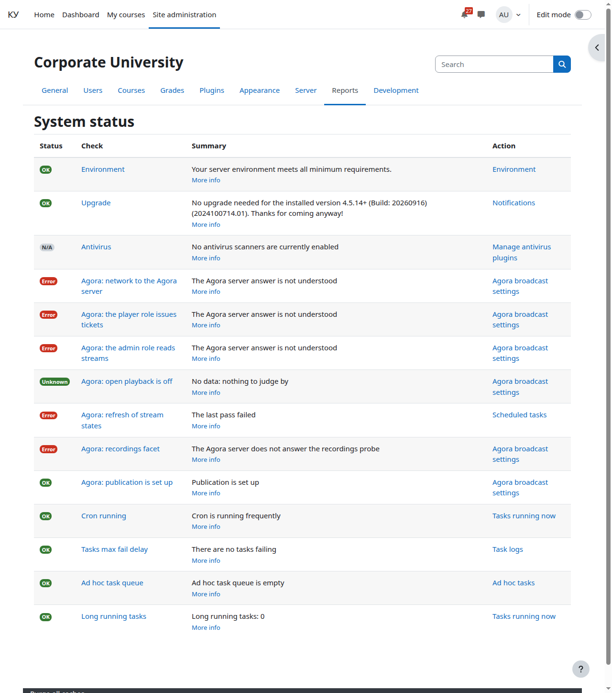
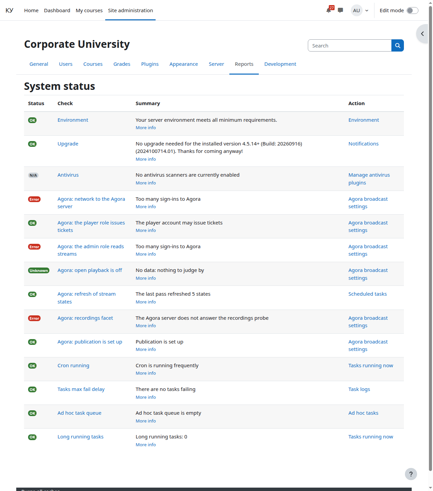
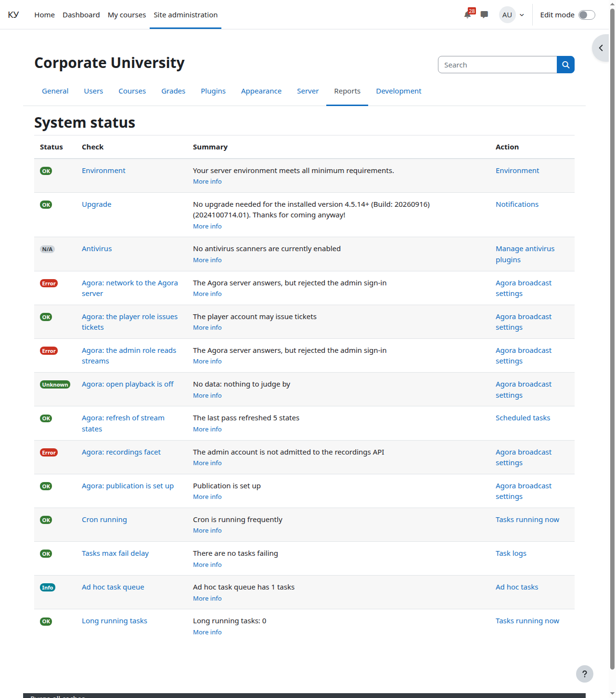
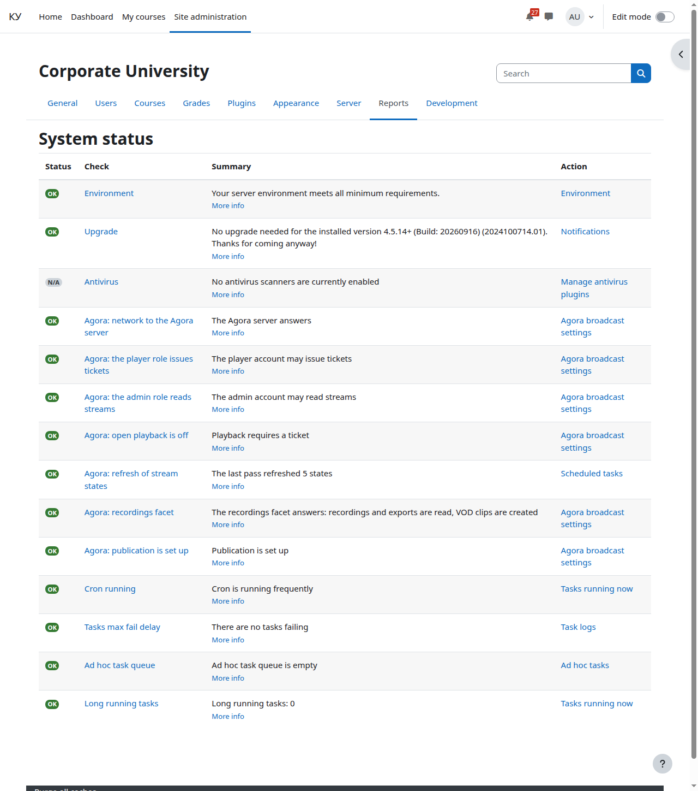

# Отчёт «Состояние системы»

Кому: администратору Moodle.

Темы раздела: [Словарь](00-glossary.md) · [Как это работает](01-how-it-works.md) · [Что понадобится](02-prerequisites.md) · [Служебные учётные записи](03-agora-accounts.md) · [Шаблон эфира, закрытый просмотр и тег](04-agora-template.md) · [Установка и обновление плагина](05-install.md) · [Настройки сайта](06-settings.md) · **Отчёт «Состояние системы»** · [Фоновые задачи и права](08-tasks-and-permissions.md) · [Корзина курса и журнал событий](09-recycle-bin-and-log.md) · [Неполадки](10-troubleshooting.md) · [Что видит оператор Agora](11-agora-console.md) · [Ограничения и чего нет в этой версии](12-limits.md)

---

**Администрирование → Отчёты → Состояние системы.** Плагин добавляет туда семь
проверок:

- **Agora: сеть до сервера Agora** — отвечает ли сервер; в подробностях число
  эфиров, видимых учётной записи `admin`;
- **Agora: роль player выписывает билеты**;
- **Agora: роль admin читает эфиры**;
- **Agora: открытое проигрывание выключено** — если на сервере Agora включён
  открытый просмотр
  ([Закрытый просмотр](04-agora-template.md#закрытый-просмотр)), проверка даёт
  предупреждение: билет в таком режиме ничего не защищает. То же предупреждение
  видит преподаватель на странице элемента;
- **Agora: обновление состояний эфиров** — ходит ли фоновая задача, которая
  держит свежими бейджи состояний. Краснеет, если последний проход был больше
  трёх минут назад или упал; в подробностях — время прохода либо текст ошибки
  сервера Agora и число эфиров, оставшихся без состояния. Ссылка «починить» у
  неё ведёт не в настройки плагина, а в **Сервер → Запланированные задачи**:
  чинится она там. Проход, который отработал, но не нашёл эфиров на сервере
  Agora, виден отдельным числом: часть эфиров — предупреждение («оператор
  удалил эфир», поле — «Эфир» в настройках элемента), все до одного — ошибка
  (подменённый адрес сервера Agora или другая версия интерфейса, поле — «Адрес
  сервера Agora»). Если элементов «Эфир Agora» на сайте нет, проверка
  показывает «неприменимо».
- **Agora: публикация настроена** — всё ли для вещания преподавателей из
  курсов. Проверяет две вещи и называет неудавшуюся с причиной и полем:
  адрес публикации (читается с сервера Agora; если его нет — запасной адрес
  из настройки «Адрес публикации (запасной)») и диапазон портов публикации
  (задан и имеет свободные порты; в подробностях зелёной проверки — адрес и
  число свободных портов). Красная при незаданном диапазоне отсылает к полю
  настроек плагина. В зелёной проверке отдельной строкой видно
  «записей без экспорта дольше часа: N»: записи, которые готовы, а ролик
  экспорта так и не появился — плагин уже записал об этом событие в журнал,
  однократно на запись.
- **Agora: роутинг записей** — есть ли на сервере Agora фасет записей. Проба
  идёт чтением списка записей заведомо существующего эфира. Зелёная: записи
  и экспорты читаются, ролики создаются. Жёлтая «В Agora нет фасета
  записей»: запись показывается из архива, ролики не создаются — чинится
  обновлением Agora до версии с записями, а не полем настроек. Красные:
  «учётная запись admin не допущена к API записей» (чинится логином и
  паролем admin) и «сервер Agora не отвечает на пробу записей» (чинится
  адресом сервера). Если элементов «Эфир Agora» на сайте нет, проверка
  показывает «неприменимо».

Так выглядит неверный пароль учётной записи admin: проверки, которым нужен
вход под этой записью, краснеют со сводкой «Сервер Agora отвечает, но вход
учётной записи admin отклонён», в подробностях названо поле «Пароль учётной
записи admin», а в столбце «Действие» стоит ссылка на страницу настроек, где
это чинится. Проверка player при этом остаётся зелёной: у неё свой пароль.

Три первые проверки называют причину отказа своей сводкой:

- «Сервер Agora не отвечает» — нет сети до сервера или неверный адрес; поле —
  «Адрес сервера Agora»;
- «…вход учётной записи … отклонён» — неверный логин или пароль;
- «Роль не даёт выписывать билеты», «Роль не даёт читать эфиры» — сервер
  Agora ответил 403: учётной записи в консоли Agora выдана не та роль;
- «Лицензия Agora не включает учётные записи» — сервер Agora ответил на вход
  кодом 404; чинится лицензией Agora, а не полем настроек;
- «Слишком частые входы в Agora» — сервер Agora пускает не больше 10 входов в
  минуту с одного адреса и логина; подождите минуту и обновите отчёт;
- «Ошибка на стороне Agora: код N» — сервер Agora ответил ошибкой 5xx; в
  подробностях текст ответа, чинит оператор Agora;
- «Ответ сервера Agora не разобран» — ответ пришёл с кодом успеха, но это не
  объект JSON: обычно страница прокси или чужой сервис по «Адресу сервера
  Agora»; в подробностях — начало ответа;
- «Проверка не прошла: код N» — любой другой код (например, 404 не на вход, а на
  запрос); причина — в подробностях, а роль не называется: она в этом случае
  неизвестна;
- «Проверка не прошла: ответа сервера Agora не было» — отказ без ответа и без
  известной причины (например, сбой в самом Moodle); причина — в подробностях.

Ответ «кто вошёл» без роли (в том числе пустой `{}`) проверки ролей называют
«Ответ сервера Agora не разобран», а не «роль не даёт». Когда сервер Agora не
отвечает, проверки ролей показывают «неизвестно» со сводкой «Данных нет: сервер
Agora не отвечает» — чинится это адресом, как у проверки сети.

Так выглядит «Адрес сервера Agora», который ведёт не на Agora, а на чужой
сервис, отвечающий HTML-страницей с кодом 200. Три проверки со входом говорят
«Ответ сервера Agora не разобран», в подробностях — начало ответа (здесь —
заголовок HTML-страницы). Проверка открытого проигрывания показывает
«Неизвестно» со сводкой «Данных нет: судить не по чему»: политику допуска
прочитать не удалось, и «в порядке» она не скажет. «Обновление состояний
эфиров» краснеет сводкой «Последний проход не удался», как только фоновая
задача пройдёт под этим адресом. Чинится полем «Адрес сервера Agora»; после
исправления все семь проверок зеленеют со следующим проходом задачи.

Так выглядят слишком частые входы: больше 10 попыток входа за минуту с адреса
сервера Moodle под логином учётной записи admin. Проверки, которые входят под
этой записью, краснеют сводкой «Слишком частые входы в Agora»; проверка player
зелёная — у неё свой логин, и темп считается отдельно. Учётная запись при этом
не блокируется: через минуту окно темпа закрывается, и отчёт, открытый заново,
зелёный. Если сводка держится дольше, под этим логином с адреса Moodle
продолжают входить.

Исправьте пароль и сохраните.

Отсутствие данных показывается как «неизвестно», а не как «в порядке». Когда
что-то не работает, смотреть надо сюда: каждый отказ плагина называет свою
проверку и своё поле настроек.

---

← Предыдущая: [Настройки сайта](06-settings.md) · Следующая: [Фоновые задачи и права](08-tasks-and-permissions.md) →
