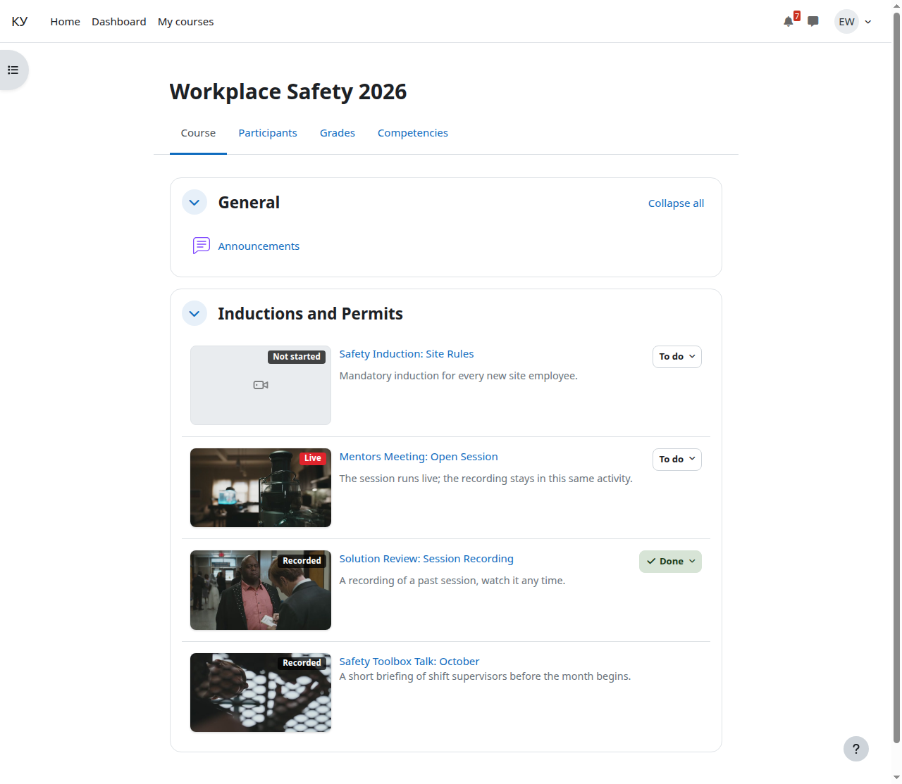

# Как открыть эфир

Кому: слушателю.

Темы раздела: **Как открыть эфир** · [Бейджи и заглушки](02-badges.md) · [Страница эфира](03-broadcast-page.md) · [Запись после эфира](04-recording.md) · [Почему может не играть](05-not-playing.md) · [Где смотреть своё прохождение](06-completion.md)

---

Занятие лежит на странице курса обычным элементом — рядом с заданиями и
тестами. Называется **«Эфир Agora»**. Ничего устанавливать и никуда отдельно
входить не нужно: видео играет прямо на странице, под вашей учётной записью
Moodle.

На карточке элемента видно имя занятия, бейдж состояния, кадр из эфира и дату
начала, если преподаватель её задал.

---

Следующая: [Бейджи и заглушки](02-badges.md) →
