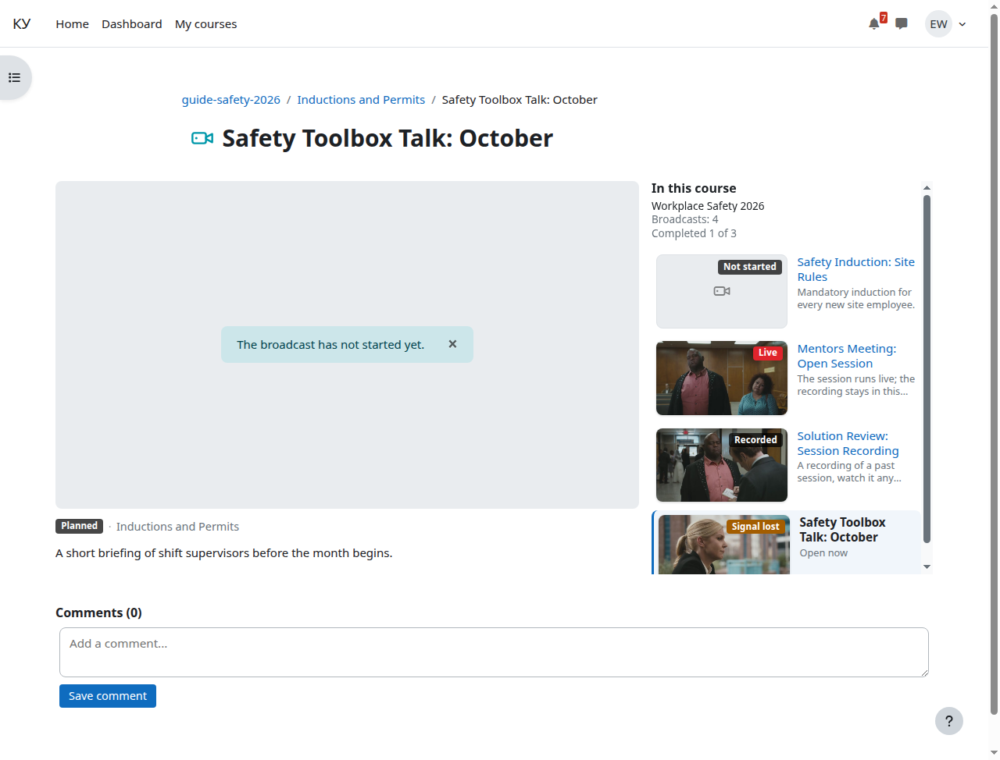
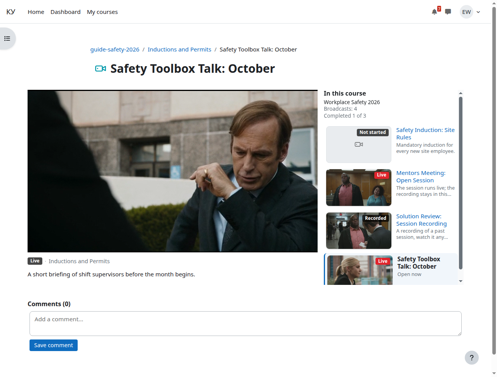
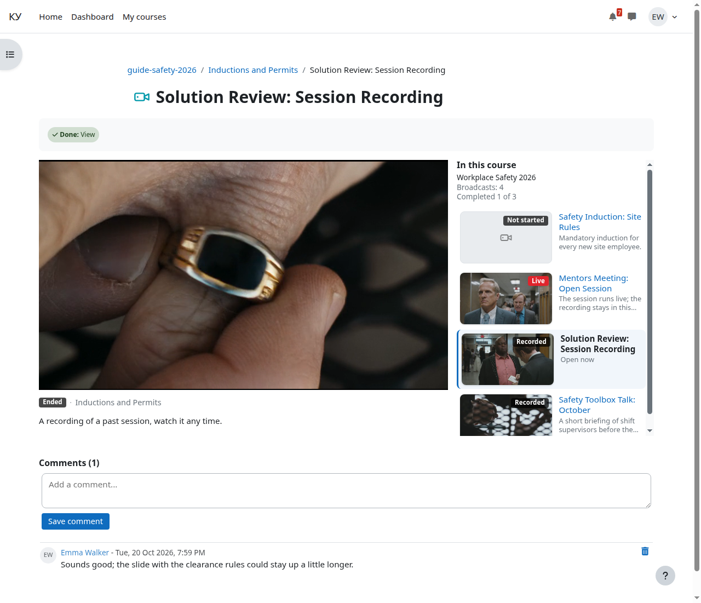

# Страница эфира

Кому: слушателю.

Темы раздела: [Как открыть эфир](01-open.md) · [Бейджи и заглушки](02-badges.md) · **Страница эфира** · [Запись после эфира](04-recording.md) · [Почему может не играть](05-not-playing.md) · [Где смотреть своё прохождение](06-completion.md)

---

Страница сложена в две строки.

**Сверху — плеер, справа от него список эфиров этого курса** во всю высоту
плеера. Открытый эфир помечен, у остальных бейдж состояния и кадр. В заголовке
списка — число эфиров курса и, если в курсе включено прохождение, сколько из них
пройдено. На узком экране список свёрнут по высоте, ссылка «Показать все»
разворачивает его целиком.

**Пришли до начала — просто оставайтесь на странице.** Пока на месте плеера
надпись «Эфир ещё не начался», страница сама раз в 15–20 секунд проверяет,
не пошёл ли эфир, и, когда пошёл, показывает плеер — перезагружать её не нужно.
От начала эфира до плеера проходит не больше 35 секунд.

Если в это время вы смотрите запись прошлого занятия, она не прервётся: над
плеером появится плашка «Эфир начался» с кнопкой «Перейти к эфиру». Нажмёте —
запись сменится эфиром; не нажмёте — досмотрите запись.

**Снизу — комментарии**, а справа от них карточки других ваших курсов.

Комментарии — обычные комментарии Moodle: поле нового комментария сверху, лента
ниже, отправка без перезагрузки страницы. Их видит и преподаватель, он же может
удалить чужой комментарий. К моменту времени в видео комментарии не привязаны —
это не чат.

**Карточки других курсов** — до шести курсов, на которые вы записаны, и только
те, где есть хотя бы одно доступное вам занятие. Карточка ведёт не на страницу
курса, а сразу на занятие:

1. если в том курсе прямо сейчас идёт эфир — на него; такая карточка помечена
   бейджем «В эфире» и идёт первой;
2. иначе, если в курсе считается прохождение, — на первое занятие с условием
   «просмотрел элемент», которое вы ещё не открывали; подстрока скажет
   «Дальше: …». Занятия, у которых этого условия нет, в счёт не идут: по ним
   негде увидеть, открывали вы их или нет;
3. иначе — на первое доступное занятие курса. Сюда же попадают курсы, где
   прохождение выключено, где условия «просмотрел элемент» нет ни у одного
   занятия и где вы уже открыли все такие занятия.

Если курс у вас один и показывать нечего, колонки с курсами нет вовсе — её
место занимает соседний блок, пустых рамок не остаётся.

На узком экране обе правые колонки уходят вниз, под плеер.

---

← Предыдущая: [Бейджи и заглушки](02-badges.md) · Следующая: [Запись после эфира](04-recording.md) →
