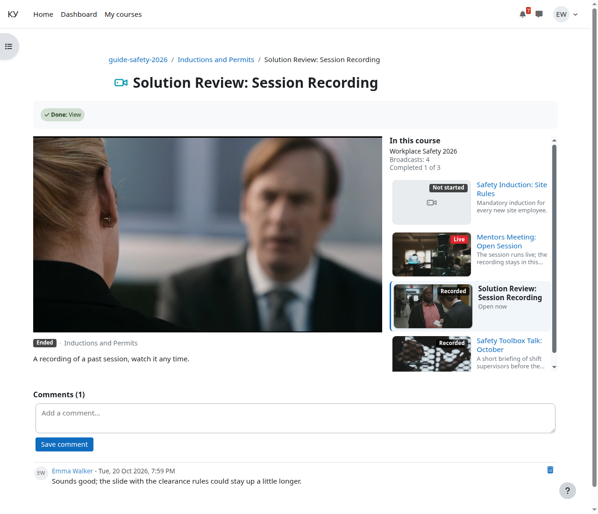

# Запись после эфира

Кому: слушателю.

Темы раздела: [Как открыть эфир](01-open.md) · [Бейджи и заглушки](02-badges.md) · [Страница эфира](03-broadcast-page.md) · **Запись после эфира** · [Почему может не играть](05-not-playing.md) · [Где смотреть своё прохождение](06-completion.md)

---

Если занятие записывалось, после его окончения на той же странице играет
запись — как обычный ролик, который можно перематывать. Второй вход, другое
место или отдельная ссылка не нужны: элемент, в котором прошёл эфир,
показывает и эфир, и запись.

Ролик появляется не мгновенно. Сначала закрытая запись экспортируется в
ролик на сервере Agora — обычно это минуты; пока экспорт не готов, на месте
плеера надпись «Запись скоро появится». Открытая страница сама проверяет
готовность и подменяет надпись плеером — перезагружать её не нужно.

Запись хранится ограниченное время — его задаёт не курс, а настройки сервера
видео.

У элементов, созданных до того, как преподаватели стали вести эфиры сами, и
у эфиров оператора запись может играть иначе — лентой архива с начала до
конца: перемотка есть, а живого края нет. Внешне это тот же плеер на той же
странице.

Строка «Запись этого эфира не велась» значит ровно то, что написано: занятие
прошло без записи, второй раз его не посмотреть.

Если на той же странице снова начнётся эфир — например, у элемента-наследия
следующее занятие идёт под тем же элементом, — запись, которую вы смотрите,
не оборвётся. Над плеером появится плашка «Эфир начался» с кнопкой «Перейти
к эфиру»: нажмёте — на месте записи откроется эфир.

---

← Предыдущая: [Страница эфира](03-broadcast-page.md) · Следующая: [Почему может не играть](05-not-playing.md) →
