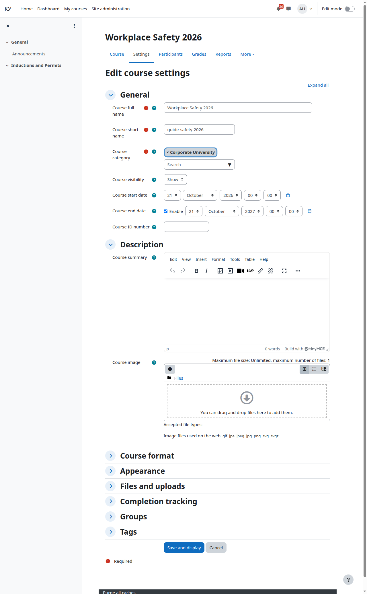

# Курс

Кому: преподавателю.

Темы раздела: **Курс** · [Добавить элемент «Эфир Agora»](02-add-broadcast.md) · [Режим показа, дата начала и описание](03-display-mode.md) · [Прохождение](04-completion.md) · [Страница курса](05-course-page.md) · [Страница элемента вашими глазами](06-broadcast-page.md) · [Слушатели: запись на курс и группы](07-learners.md) · [Отчисление и что происходит с билетом](08-unenrol.md) · [Отчёт о прохождении](09-completion-report.md) · [Комментарии](10-comments.md) · [Если у слушателя не играет](11-when-it-does-not-play.md)

---

Курс — обычный курс Moodle, ничего особенного плагин не требует. Если
собираетесь отмечать прохождение ([Прохождение](04-completion.md)), включите в
настройках курса отслеживание выполнения — раздел «Отслеживание выполнения»
формы курса.

---

Следующая: [Добавить элемент «Эфир Agora»](02-add-broadcast.md) →
