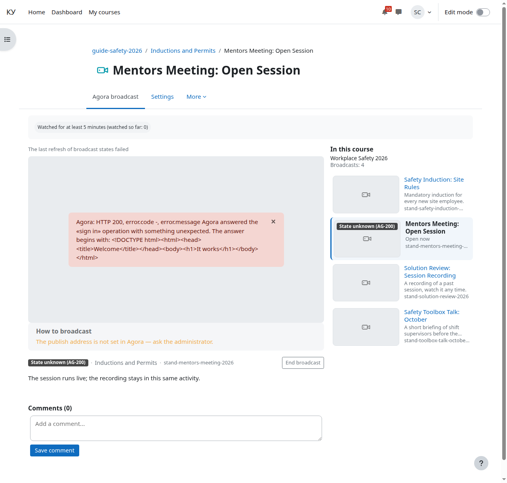
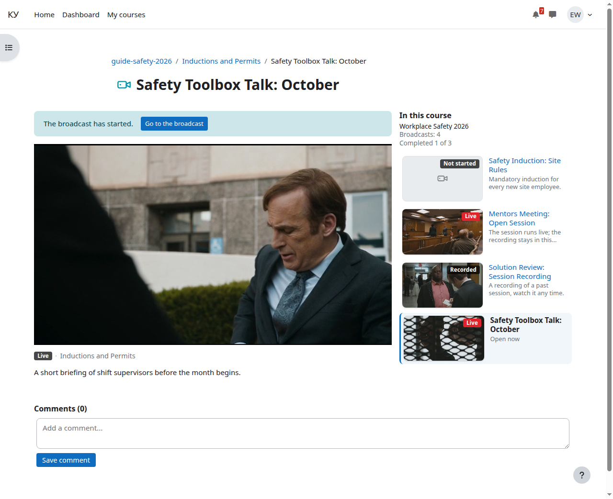
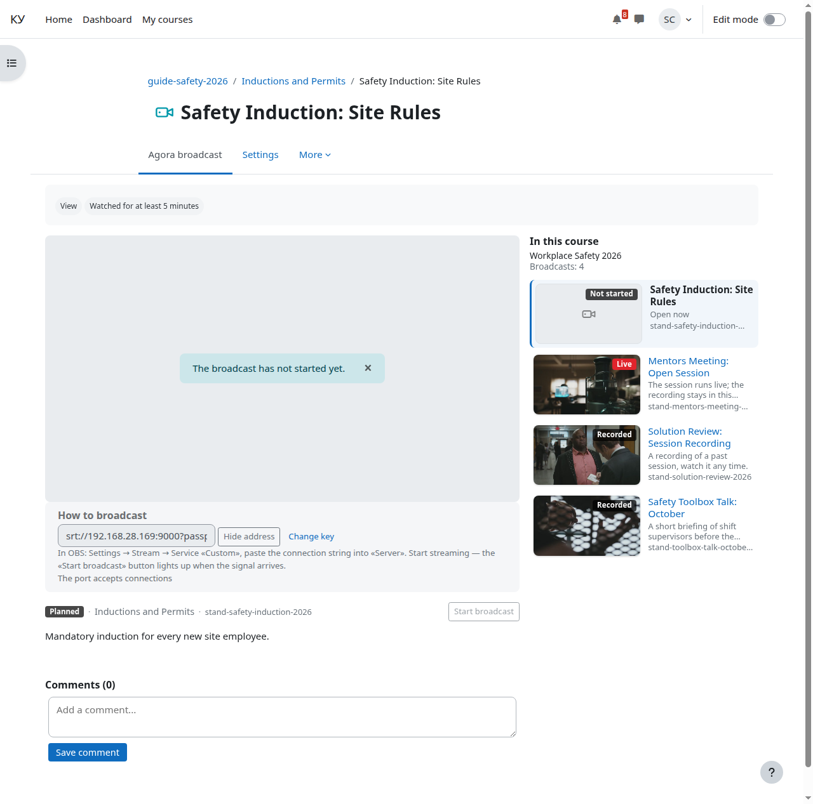

# Страница элемента вашими глазами

Кому: преподавателю.

Темы раздела: [Курс](01-course.md) · [Добавить элемент «Эфир Agora»](02-add-broadcast.md) · [Режим показа, дата начала и описание](03-display-mode.md) · [Прохождение](04-completion.md) · [Страница курса](05-course-page.md) · **Страница элемента вашими глазами** · [Слушатели: запись на курс и группы](07-learners.md) · [Отчисление и что происходит с билетом](08-unenrol.md) · [Отчёт о прохождении](09-completion-report.md) · [Комментарии](10-comments.md) · [Если у слушателя не играет](11-when-it-does-not-play.md)

---

Слушатель видит на этой странице плеер, список эфиров курса, комментарии и
карточки своих других курсов — это описано в
[документе для слушателя](../student/03-broadcast-page.md). Вам видно то же
самое и ещё четыре вещи.

**Имя эфира на сервере Agora.** Слушателю его не показывают — вам оно нужно,
чтобы объясниться с оператором.

**Кнопка «Открыть в панели Agora».** Ведёт на этот эфир в консоли Agora. Её
видит тот, кто может редактировать курс; слушателям её нет.

**Скрытые и закрытые элементы в списке эфиров курса.** Скрытый элемент
слушатель здесь не видит, а вы видите его приглушённым с ярлыком ядра Moodle
«Скрыто от студентов»; элемент, закрытый ограничением доступа, идёт без ссылки,
с замком вместо кадра и с текстом условия. Целью карточки другого курса такой
элемент становится по тому же правилу, что и любой другой: он должен быть
доступен смотрящему. Слушателю скрытый эфир недоступен и целью не станет, а вам
в курсе, где вы видите скрытое, — станет.

В заголовке списка — число «Эфиров: N». Второе число, «Пройдено k из M»,
показывают только слушателю: прохождение вам не считают, и считать нечего.

**Строка «Состояния эфиров не обновлялись N мин»** — приглушённая строка над
плеером. Она значит, что фоновая задача, которая держит свежими бейджи и кадры
соседних эфиров, не отрабатывала дольше трёх минут; обычно потому, что на сайте
не ходит cron. Если последний запуск задачи завершился ошибкой, строка другая:
«Последний проход обновления состояний эфиров не удался» — она появляется
сразу, не дожидаясь трёх минут. Пока строка висит, бейджи и кадры у соседей
пропадают. Слушателю эти строки не показываются; чинит их администратор Moodle.

На снимке задача упала потому, что «Адрес сервера Agora» в настройках сайта
ведёт не на Agora, — поэтому и сам плеер вместо эфира показывает отказ сервера.
Когда администратор исправит адрес и задача пройдёт снова, строка пропадёт.

Ещё одно отличие: карточки других курсов ведут вас на живой эфир, а если живых
нет — на первый эфир курса. Подсказка под карточкой есть и у вас — «В эфире: …»
или «Дальше: …», — но у вас она называет ровно тот эфир, куда карточка ведёт:
живой или первый в курсе. Слушателю та же подсказка называет первый
непройденный эфир, потому что прохождение считают ему, а не вам.

Бейджи и кадры соседних эфиров в списке берутся только из кэша: про эфиры
соседей страница сервер Agora не спрашивает. Про открытый эфир спрашивает — его
состояние, если то, что знает сайт, старше 15 секунд (один запрос на эфир за
15 секунд, сколько бы слушателей ни открыло страницу), а при показе записи ещё
и границы архива. Если вы можете редактировать курс, добавляется чтение
политики допуска — раз в минуту на весь сайт. Пока кэш не прогрет, соседи
рисуются без бейджей и без кадров; это не ошибка.

Открытая страница без живого плеера раз в 15–20 секунд спрашивает сайт — не
сервер Agora, — не начался ли эфир, и сама меняет заглушку на плеер. Если на
странице идёт запись, она не обрывается: над ней появляется плашка «Эфир
начался» с кнопкой «Перейти к эфиру».

И если на сервере Agora включён открытый просмотр для всех, вы увидите на этой
странице предупреждение: билеты в таком режиме ничего не защищают. Это чинит
администратор Moodle вместе с оператором Agora.

## Ведение эфира

Элемент, созданный по шаблону, — полный жизненный цикл занятия. Слушатели
видят эфир только после вашего решения, запись ведётся с этого же момента.

**Блок «Как вещать»** стоит на странице, пока эфир не завершён. По умолчанию
он свёрнут за кнопкой «Показать адрес»: ни адреса, ни ключа на странице нет.
Кнопка открывает строку подключения вида `srt://<адрес>:<порт>?passphrase=<ключ>`
(нажатие записывается в журнал событий без самого ключа), «Скрыть адрес»
сворачивает блок обратно. Строка — единственное,
что вводится в энкодер: в OBS это «Настройки» → «Трансляция» → сервис
«Другое», строка в поле «Сервер».
«Сменить ключ» генерирует новый: идущее вещание оборвётся, пока вы не
введёте новую строку в энкодер, — кнопка предупреждает об этом. Меняйте
ключ, только если он мог утечь. Под строкой — состояние порта: «Порт
принимает подключения» или «Порт не поднят: … — сообщите
администратору»: второе значит, что настроено что-то не так, а не то, что
вы ещё не включили энкодер.

**Сигнал идёт, слушатели его не видят.** Как только энкодер подключился, на
месте плеера у вас — живая картинка проверки и кнопка «Начать эфир».
Слушатели в это время видят «Эфир ещё не начался»: сигнал сам по себе их не
допускает. Проверьте картинку и звук, затем нажимайте: страницы слушателей
переключатся на плеер сами, а в Agora стартует запись с именем элемента.
Без сигнала кнопка неактивна и объясняет, чего ждёт: «Сигнала ещё нет:
запустите энкодер — кнопка загорится, когда сигнал появится».

**«Завершить эфир» — навсегда.** Кнопка останавливает запись, снимает
публикацию с эфира и открывает запись слушателям; повторного эфира в этом
элементе не будет — подтверждение спрашивает именно об этом. На странице
завершённого элемента строка «Эфир завершён: …» называет способ и момент:
«кнопкой преподавателя», «автоматически после обрыва сигнала» или
«автоматически, запись закрыла система» (у записи есть предельная
длительность — 8 часов по умолчанию). Рядом подсказка: новое занятие —
новый элемент, этот можно дублировать.

**Авто-завершение по тишине.** Если энкодер молчит дольше порога, который
задал администратор (по умолчанию 10 минут), эфир завершает плановая
задача: запись останавливается, слушатели переходят к записи, способом
завершения на странице станет «автоматически после обрыва сигнала». До
порога слушатели видят «сигнал пропал», и эфир продолжается — верните
энкодер. Если завершение не удалось (сеть до Agora упала), элемент не
зависает в подвешенном виде: на странице видно, какое действие не
выполнилось, и его повторят вы той же кнопкой или плановая задача.

---

← Предыдущая: [Страница курса](05-course-page.md) · Следующая: [Слушатели: запись на курс и группы](07-learners.md) →
