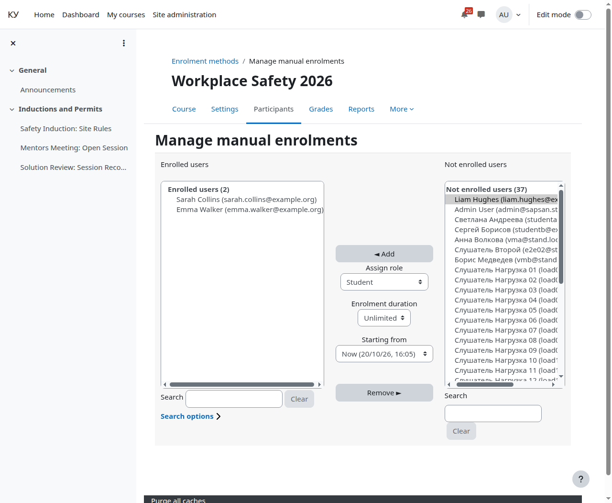
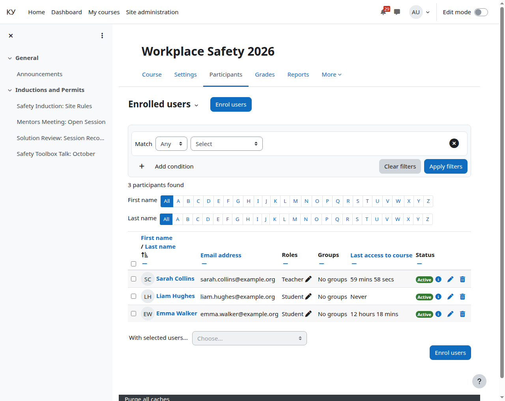

# Слушатели: запись на курс и группы

Кому: преподавателю.

Темы раздела: [Курс](01-course.md) · [Добавить элемент «Эфир Agora»](02-add-broadcast.md) · [Режим показа, дата начала и описание](03-display-mode.md) · [Прохождение](04-completion.md) · [Страница курса](05-course-page.md) · [Страница элемента вашими глазами](06-broadcast-page.md) · **Слушатели: запись на курс и группы** · [Отчисление и что происходит с билетом](08-unenrol.md) · [Отчёт о прохождении](09-completion-report.md) · [Комментарии](10-comments.md) · [Если у слушателя не играет](11-when-it-does-not-play.md)

---

Записывать на курс можно как обычно — любым способом записи Moodle. Ручная
запись: **Участники → Записать пользователей**, либо **Участники → Способы
записи → Ручная запись**.

Роль выбирается **до** нажатия «Добавить»: запись уходит с той ролью, которая
выбрана в этот момент. Записанный без роли останется в списке участников без
прав и смотреть не сможет.

Проверяйте результат на странице участников, а не по факту нажатия кнопки: у
каждого должна стоять роль.

**Группы** работают штатно. Ограничение «только группа Б» ставится обычным
ограничением доступа Moodle на элементе — плагин его соблюдает, отдельной
настройки у него нет. Группы заводятся как обычно: **Участники → Группы**.

Итого право смотреть равно членству в курсе: слушатель записан, элемент ему
доступен, ограничения доступа соблюдены.

---

← Предыдущая: [Страница элемента вашими глазами](06-broadcast-page.md) · Следующая: [Отчисление и что происходит с билетом](08-unenrol.md) →
