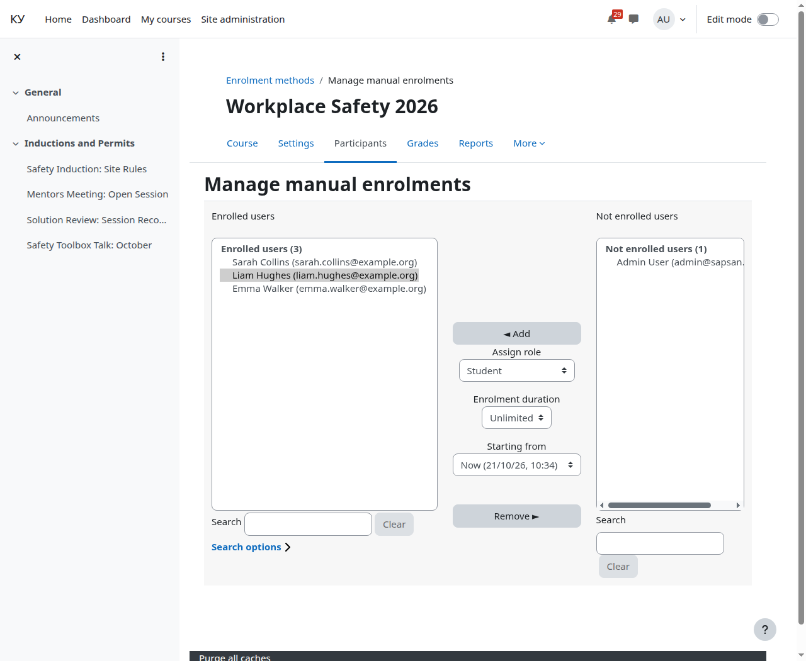
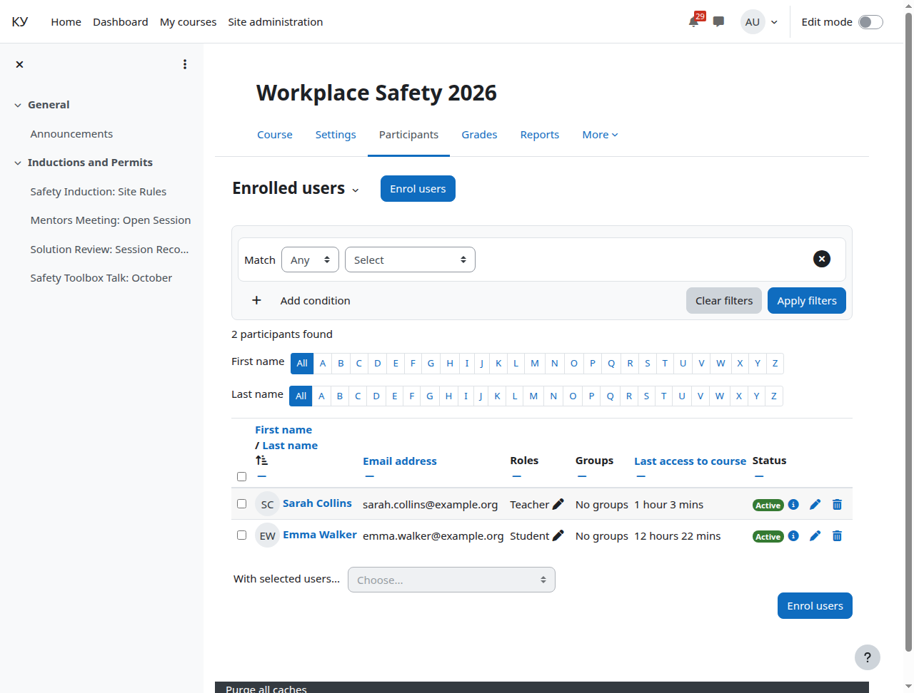
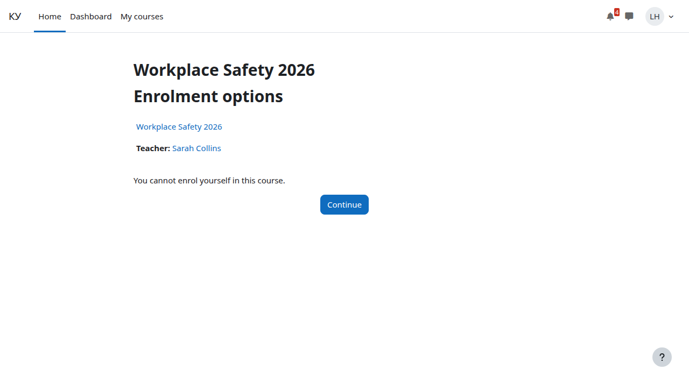

# Отчисление и что происходит с билетом

Кому: преподавателю.

Темы раздела: [Курс](01-course.md) · [Добавить элемент «Эфир Agora»](02-add-broadcast.md) · [Режим показа, дата начала и описание](03-display-mode.md) · [Прохождение](04-completion.md) · [Страница курса](05-course-page.md) · [Страница элемента вашими глазами](06-broadcast-page.md) · [Слушатели: запись на курс и группы](07-learners.md) · **Отчисление и что происходит с билетом** · [Отчёт о прохождении](09-completion-report.md) · [Комментарии](10-comments.md) · [Если у слушателя не играет](11-when-it-does-not-play.md)

---

Мало не пустить на страницу — надо отобрать уже выписанный билет. Плагин
отзывает живые билеты человека на эфиры курса по пяти событиям Moodle:

- отчисление с курса;
- приостановка записи на курс;
- исключение из группы;
- снятие роли, после которого элемент стал недоступен;
- удаление пользователя.

Сервер Agora закрывает идущий просмотр за секунды — не в конце занятия, а
сразу.

Снять с курса: **Участники** → значок корзины в строке человека, либо та же
страница ручной записи.

Отчисленный на страницу элемента уже не попадает: ссылка ведёт на страницу
зачисления с отказом, плеера он не видит вовсе.

Что важно помнить:

- **Приостановка записи на курс** отзывает билеты так же, как отчисление.
- **Правка дат записи на курс** поводом для отзыва не считается: запись
  осталась активной.
- **Запись, кончившаяся по сроку**, события Moodle не порождает. Такой билет
  доживает до конца своего срока; срок билета задаёт администратор Moodle по
  длине занятия.
- **Ссылка на видео, пересланная за пределы курса**, с чужого адреса не
  играет — это защита, а не поломка.

---

← Предыдущая: [Слушатели: запись на курс и группы](07-learners.md) · Следующая: [Отчёт о прохождении](09-completion-report.md) →
