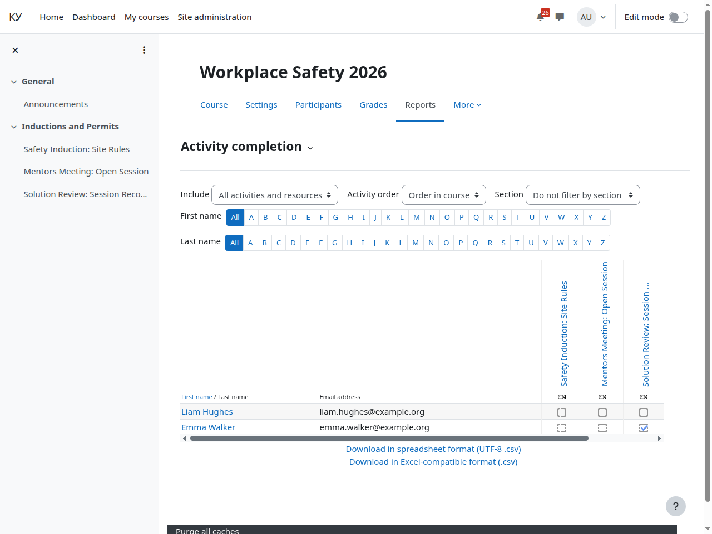

# Отчёт о прохождении

Кому: преподавателю.

Темы раздела: [Курс](01-course.md) · [Добавить элемент «Эфир Agora»](02-add-broadcast.md) · [Режим показа, дата начала и описание](03-display-mode.md) · [Прохождение](04-completion.md) · [Страница курса](05-course-page.md) · [Страница элемента вашими глазами](06-broadcast-page.md) · [Слушатели: запись на курс и группы](07-learners.md) · [Отчисление и что происходит с билетом](08-unenrol.md) · **Отчёт о прохождении** · [Комментарии](10-comments.md) · [Если у слушателя не играет](11-when-it-does-not-play.md)

---

**Отчёты → Выполнение элементов курса** показывает, кто открыл элемент и кто
набрал нужные минуты, рядом с выполнением заданий и тестов.

Напоминание из раздела [Прохождение](04-completion.md): отметка по минутам
появляется после закрытия плеера плюс интервал фоновой задачи, а не в момент
просмотра.

---

← Предыдущая: [Отчисление и что происходит с билетом](08-unenrol.md) · Следующая: [Комментарии](10-comments.md) →
