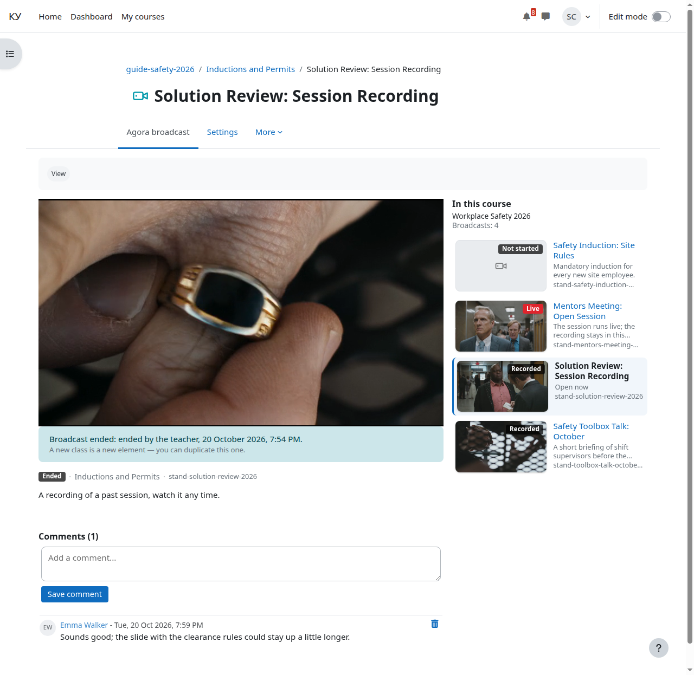

# Комментарии

Кому: преподавателю.

Темы раздела: [Курс](01-course.md) · [Добавить элемент «Эфир Agora»](02-add-broadcast.md) · [Режим показа, дата начала и описание](03-display-mode.md) · [Прохождение](04-completion.md) · [Страница курса](05-course-page.md) · [Страница элемента вашими глазами](06-broadcast-page.md) · [Слушатели: запись на курс и группы](07-learners.md) · [Отчисление и что происходит с билетом](08-unenrol.md) · [Отчёт о прохождении](09-completion-report.md) · **Комментарии** · [Если у слушателя не играет](11-when-it-does-not-play.md)

---

Под плеером стоят обычные комментарии Moodle, привязанные к элементу: поле
нового комментария сверху, лента под ним, добавление и удаление без
перезагрузки страницы. Комментарии не привязаны к моменту времени в видео: это
не чат.

**Кто может писать.** Слушатель с правом «Комментировать эфир Agora» — по
умолчанию оно есть у слушателя, преподавателя и управляющего. Сверх него нужны
включённые комментарии сайта и включённая настройка плагина
[«Комментарии под плеером»](../admin/06-settings.md#комментарии-под-плеером); и
то и другое в руках администратора Moodle. Если чего-то из этого нет, слушатель
видит ленту, но не видит поля нового комментария, а при выключенной настройке
плагина области комментариев нет вовсе.

**Как удалять.** Чужой комментарий удаляете вы — значком корзины в строке
комментария. Это штатное право Moodle «удалять комментарии».

**Модерация.** Весь список комментариев сайта администратор видит отчётом
**Администрирование → Отчёты → Комментарии**. Выключить комментарии у одного
эфира нельзя — выключатель только сайтовый. Комментарии входят в резервную
копию курса и восстанавливаются вместе с элементом.

---

← Предыдущая: [Отчёт о прохождении](09-completion-report.md) · Следующая: [Если у слушателя не играет](11-when-it-does-not-play.md) →
